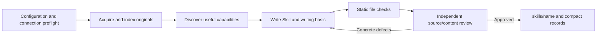

# Research Skill Creation Pipeline

Discover reusable capabilities from research papers, documentation and code with a native Codex
Agent. The pipeline prepares original resources, guides concise English Skill writing, checks
files and independently reviews the content against sources. A task description is optional.

## Prepare

Python 3.11+, Git and authenticated Codex CLI on PATH. Optional parsers:

```text
python -m pip install "PyYAML>=6,<7" "pypdf>=5,<7"
```

Poppler improves PDF text extraction and page rendering. Target tools do not need to be installed:
this version reviews their usage instructions without executing tools, examples or generated scripts.

## Build

Save sources.json (local paths resolve relative to this file):

```json
{
  "sources": [
    {"path": "./paper.pdf"},
    {"repo": "https://github.com/organization/project.git", "ref": "<commit>"}
  ]
}
```

```text
python -m creation_pipeline build sources.json
```

The selected model/connection is tested before resource acquisition. Production has no implicit
candidate, source-size, model-time or turn quotas. An explicit development profile can limit trials.
Agent reads originals and prepared views selectively; resources are not injected wholesale.
Scoped supplemental research resolves gaps related to inputs, not unrelated research topics.



Approved pure packages go directly to skills/name. Approval means source/content review, not
runtime verification, scientific validation or measured Agent benefit. Review includes explicit
input/output contracts, source-supported preparation, representative Usage and concise expression.

Browse [current Skills](skills/README.md) and the separately stored [legacy collection](skills/legacy-pipeline/README.md).
Historical imports retain their own source and validation records rather than entering the current approval catalog.

Successful builds retain one package and compact records under .pipeline/records. Unfinished
builds retain their latest drafts there; full workspaces expire after 7 days. Registered cache units
expire after 30 unused days. Cleanup runs on the next build startup, never as a background service.
Pinned and active batches are protected; historical unregistered directories are not auto-deleted.

```text
python -m creation_pipeline build sources.json --no-adopt
python -m creation_pipeline retention
python -m creation_pipeline pin <build-id>
python -m creation_pipeline unpin <build-id>
python -m creation_pipeline prune --dry-run
```

--no-adopt retains approved packages in the local archive. --keep-debug retains full successful
workspaces for the normal retention window; use pin for indefinite retention.

## Documentation

- [Usage](docs/pipeline/usage.md), [configuration](docs/pipeline/configuration.md)
- [Resources](docs/pipeline/resources.md), [scoped research](docs/pipeline/research-access.md)
- [Acceptance](docs/pipeline/acceptance.md), [outputs and retention](docs/pipeline/outputs.md)
- [Design](docs/pipeline/design.md), [code organization](docs/pipeline/code-organization.md), [status](docs/pipeline/status.md)
- [Minimum content](docs/skills/minimum.md), [packaging](docs/skills/packaging.md)
- [Examples](examples/README.md): curated batches with input, discovery, writing basis and final review

Engineering regression tests: python -m unittest discover -s tests -q.
Agent benefit evaluation remains separate. Direct model API/Ollama backends are unsupported.
