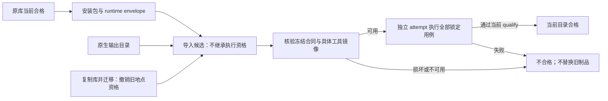

# 真实生成 Skill 的共享工具交付与恢复验证

基线 `78d9414`，分支 `pipeline-with-shared-docker`。来源是前轮真实生成并独立审阅、
实际执行通过的 A（21 个用例）和 B（20 个用例），不是新造的手工验收 fixture。
来源及生成证据见 [验收专用阶段](shared-tool-acceptance-model-20261101.md)。

结果：两个真实 Skill 各完成 5 条成功路径，共 **205/205**；旧 Open Babel 自包含模式完成
导入与迁移重验 **16/16**。10 条负例按预期拒绝。本轮 **0 模型、0 环境构建、0 工具构建**。
完整回归 **677 项：674 通过、3 跳过**，三个提示自检通过；没有提示/schema 修改或 freeze。
机器索引：[shared-tool-delivery-results-20261101.json](../../validation/deepseek-api/shared-tool-delivery-results-20261101.json)。

本轮复用各自已锁定的合同，不重新发现、编写或调用验收模型。内容审阅证明仍绑定原始冻结字节，
执行资格不继承：导入与迁移先进入不合格状态，不能安装；只有当前目录的新 Docker 执行及
qualify 通过才能恢复 accepted。两个 Skill 即使名称相同，也分别在独立库验证，没有互相覆盖。

验证脚本：`validation/deepseek-api/verify_shared_tool_delivery.py <fresh-absolute-root>`。
`--offline` 只检查真实来源输入并保存摘要。正式实验从入口拦截模型调用和 LocalExecutor.build，
同时记录实际 Docker 命令；环境/工具两类新构建均不允许。证据均用现有 sanitized/write_json。

| 路径 | 预期行为与验证点 |
| --- | --- |
| 从原正式库安装 | 当前资格核验；包字节不变；旁置完整 runtime envelope |
| envelope 导入 | 先为 candidates，不可安装；新 attempt 执行自己的原锁定合同后合格 |
| 原生输出目录导入 | 同样撤销旧执行资格；不依赖先前安装路径 |
| 同主机目录迁移 | 复制后旧地点资格失效；relocate 显式撤销；当前目录新执行后合格 |
| 显式恢复 / rebuild | 只核验具体共享版本并重新执行，不能按旧配方重建替代版本 |
| 中断后恢复 | 注入执行前 KeyboardInterrupt，保留 pending journal；复制到新库恢复，原中断目录不改动 |
| 损坏冻结源码 | 修改隔离 envelope 副本，导入在目标库创建前拒绝 |
| 具体镜像缺失 / daemon 漂移 | 注入对应观察，当前候选不合格、零用例执行、不回退构建 |
| 裸 Skill 目录 / archive | 明确拒绝，不从文案或旧 passed 字段构造运行资格 |

原库、原冻结包、历史 attempt 和共享工具登记记录在前后按完整文件 manifest 比较。
成功恢复沿用原 revision、freeze、acceptance 指纹和具体 image/artifact，但每次产生独立执行目录；
历史执行目录不修改。测试显式使用不存在的共享登记目录，证明完整绑定及构建回执足以恢复当前
本机具体镜像；共享登记目录缺失不等于具体镜像缺失。

负例中的文件损坏是真实隔离副本修改；镜像缺失和 daemon 漂移是注明的故障注入，不宣称实际删除
用户镜像或更换 daemon。中断是在已写入 durable journal、复制构建回执之后、执行业务之前注入，
不是操作系统断电测试。失败候选保持不合格，不在同一失败目录重跑业务或改弱断言。

当前支持同 daemon 的文件 envelope、原生输出导入、路径迁移和具体版本恢复。
没有实现 OCI registry/镜像归档导入导出、跨主机自动分发、裸包自动恢复环境或替换丢失版本；
缺少具体镜像必须显式准备新修订。归档负例只验证入口拒绝，不声称读取验证了 OCI tar 内容。
本轮把不支持的导入路径从泛化的缺文件异常改为具名 ValueError，并验证目标库不会因此被创建。

历史 build receipt 会随恢复复制，其 build_calls 仍表示原构建；报告单列历史计数与本次实际
构建调用。业务重验次数不计入前轮 41/41、历史 72 条或新生成批次数。此次没有模型预算增加、
镜像/缓存清理、全局配置修改，也不以运行耗时作缓存性能对照。

| 本次独立执行 | A | B |
| --- | ---: | ---: |
| 安装 envelope 导入后执行 | 21/21 | 20/20 |
| 迁移后执行 | 21/21 | 20/20 |
| 显式 rebuild（具体版本重新核验） | 21/21 | 20/20 |
| 原生输出目录导入后执行 | 21/21 | 20/20 |
| 中断证据副本恢复后执行 | 21/21 | 20/20 |

新共享模式证据根：工作副本同级 `shared-tool-delivery-real-20261101-01`；离线预检为
`shared-tool-delivery-preflight-20261101-01`。两份原库的完整 manifest 与共享目录登记文件
前后一致；实际执行命令不引用原库或只读作者来源路径，使用新库冻结材料和具体镜像。
所有 10 个成功 attempt 路径不同。每次恢复前的资格快照、失败报告、原始 Docker 元数据命令、
source-snapshots 与逐用例报告均保留，索引覆盖 56 个证据文件及 4 个相关代码文件的 SHA256。

旧模式证据根为 `self-contained-delivery-regression-20261101-01`，使用原
`verify_shared_delivery.py` 对 `acceptance-openbabel-run74-20261029/library` 中
`chem-openbabel-convert` 重验；事前只读核验其 environment payload 不含 shared_tool。
该工具可以共享依赖环境，但仍采用旧自包含工具交付。导入 8/8、迁移 8/8，旧资格与包字节保留。

故障隔离结果：每份 Skill 的损坏 envelope 导入均在目标库创建前拒绝；镜像缺失观察返回
`image_unavailable_or_changed`，daemon 漂移返回 `different_daemon`，两者均 `runtime_blocked`、
零执行用例、不授予资格且不构建替代版本。裸包和归档的拒绝具有明确对象路径。
这些故障副本之后没有重跑；成功 A/B 原库资格始终保留，完整文件摘要不变。

回归日志为同级 `shared-tool-delivery-regression-20261101.log`；自检日志为
`shared-tool-delivery-{prompt-contract,acceptance-prompt,planner}-20261101.log`。
