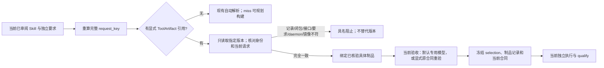

# 直接选择完整 ToolArtifact 版本

基线 `23dd7af` 已完成本机完整工具的精确请求解析、规划前自动复用、验收专用模型、交付恢复和
三路径性能测量。本轮补齐调用方明确选择版本的入口，而不是把这些已实现能力再次列为计划。

自动解析按 request_key 查找当前可用候选；同一请求可有多个实际制品。自动命中不代表调用方
已经选择某个版本。新增 `tool_artifact = {request_key, artifact_id}` 将这两个动作分开：
指定版本必须存在、记录完整、当前可用且与独立计算的当前请求完全一致，否则阻止。
不自动换版本、不回退环境 planner、不构建一个替代物。未指定引用时仍使用原自动模式。

现有 `runtime-tools-inspect` 命令现在返回可复制的 reference、recipe_key、image_id、daemon_id
和平台。离线 inspect 的 historical_unverified 不是可用性或资格证明；准备阶段仍独立核验。
引用只允许两个小写 SHA256 字段，不接受路径、tag、latest 或 OCI URL。本机 image ID 不作为 OCI digest。

运行配置示例（放在 runtime_defaults，或放在 runtime.<candidate>；独立声明也可来自 defaults）：

```json
{
  "shared_tool": {
    "closure": "all-package-and-sources-except-skill-document",
    "requirements": {"imports": {"rdkit": "unpinned"}, "executables": []},
    "interface": {
      "entrypoint": ["python", "/opt/skill/package/scripts/audit_atom_maps.py"],
      "workdir": "/opt/skill", "resources": [], "runtime_network": false
    },
    "platform": "linux/amd64", "policy": "closed-python-bundle-v1"
  },
  "tool_artifact": {
    "request_key": "77b46e53b801266c7fb79894a08a6077934372f145dd2fc9904d1920c956e21b",
    "artifact_id": "a786f6af32abc11279b54c59e8bcff50beae9351eaf08127f583257e3c4eb6be"
  }
}
```

示例引用是这台主机原 A/B 的实测版本；不保证其他主机存在。当前 requirements、constraints、
完整来源与工具包仍须独立提供并吻合，不能从制品自动复制要求来制造兼容。
`CHEM_AGENT_SHARED_TOOLS` 指向含该记录的本机目录，inspect 的 --root 不会替运行配置设置该变量。
声明支持面仍限于原 closed-python-bundle-v1，不扩大动态加载、外部进程或资源能力。



selection 存入冻结的共享绑定，并在运行时核对它与具体制品一致。选择器本身不改变 request_key
或 recipe_key；它选择已有 artifact_identity。环境计划冲突也阻止，保留具体版本及失配字段。
文件变化反馈逐路径 expected/actual；记录丢失、记录损坏、daemon 漂移与镜像不可用有各自原因。
新 Skill 不继承制品或旧 Skill 的验收通过标记。默认验收模型后端、预算和独立审阅检查未修改。

验证分两类：离线测试覆盖指定多版本中的一个、不存在的版本不得替代、改名记录伪装、闭包变化、
daemon/镜像不可用、计划冲突、冻结选择漂移，以及不提供手工 acceptance_plan 时仍进入验收专用模型。
真实实验使用原 A（21 用例）与 B（20 用例）的原合同，不做额外付费模型探针或新内容生成。
因此本轮模型计数为零不能解释成新 Skill 不需要验收模型；该路径已有前轮完整生成证据。

真实脚本 `validation/deepseek-api/verify_selected_tool.py <fresh-root>`，`--offline` 只核对两份真实
闭包与指定记录。正式实验禁止 Docker build、基础镜像解析和模型调用。自动命中与指定命中各
使用新的冻结目录及执行 attempt，保留各自完整原合同；旧库、旧冻结来源及登记文件不修改。
另在独立目录检查错误版本、当前要求变化、计划冲突、损坏记录的阻止行为。

存储与计时沿用 [三路径测量协议](shared-tool-path-metrics-20261101.md)：Engine 精确层/缓存字节、
Desktop 文件系统已用字节及交付证据逻辑字节分别记录，不相加。此前环境 miss、环境 hit/tool miss、
完整 tool hit 的 18 次/369 用例是历史受控对照；本轮仅补充显式选版本与自动命中的配对样本，
每个 Skill 每种模式一次，不能据此宣称显式引用更快。保留全部现有 Docker/BuildKit 缓存。

不支持：跨主机 OCI 分发、按 tag 选择、自动语义兼容、自动采用制品需求、缺失指定版本时重新构建
或换版本。若要改变版本，需要显式选择新的引用并建立新绑定；已冻结绑定的恢复仍按原具体版本执行。

## 本轮实测与证据

独立证据目录 `E:/Users/27343/Docker/selected-tool-real-20261101-01`：四次执行共 **82/82**，
每次环境规划、验收规划、其他模型、环境构建、工具构建调用均为 0。本轮使用原锁定合同；
不把原独立内容审阅或模型生成计作本轮新调用，也不继承旧执行资格。

| Skill / 模式 | 用例 | prepare 秒 | freeze 秒 | 核验绑定秒 | validation 秒 | 业务用例秒 | 总秒 | 证据逻辑字节 |
|---|---:|---:|---:|---:|---:|---:|---:|---:|
| A 自动 | 21 | 1.554 | 0.815 | 3.282 | 24.007 | 17.879 | 35.487 | 838467 |
| A 指定 | 21 | 1.131 | 0.731 | 2.876 | 23.706 | 17.934 | 33.615 | 839414 |
| B 自动 | 20 | 0.997 | 0.682 | 2.493 | 20.490 | 15.473 | 29.108 | 750224 |
| B 指定 | 20 | 0.811 | 0.458 | 2.402 | 19.743 | 15.400 | 26.835 | 751169 |

核验绑定耗时不是构建耗时：四次均未调用 build。业务用例耗时属于 validation 的子集，
不重复相加；total 还包括执行前后材料核验等开销。固定顺序为 A 自动、A 指定、B 自动、B 指定，
A/B 合同用例数量不同。每种只有一个样本，顺序预热及系统负载足以影响差值，不作加速比结论。

四次各自的 Engine LayersSize、BuildCache 报告字节、Desktop 文件系统已用字节增量均为 **0**，
没有新增或删除 image ID。原镜像已经预热，未清理缓存；这些零增量不代表原工具不占空间。
宿主机证据逻辑字节见表，不能当作 Docker 物理占用。每次前后的原始 Engine/文件系统快照均保留。
三路径构建对照仍以此前 18 次/369 用例的报告为准，本轮不重复计数或冒充冷构建。

A/B 各四个负例均阻止且不合格：`selected_artifact_not_found`、`selected_request_mismatch`、
`supplied_environment_plan_mismatch`、`invalid_selected_record`。未替代版本、未调用 planner/build；
所有实验后原冻结目录、登记内容不变，两个原 Skill 仍独立合格。

完整回归 **689 项：686 通过、3 跳过**；三个提示自检通过，未更改或重新冻结提示。
可复核索引：[本轮结果及 51 个文件 SHA256](../../validation/deepseek-api/shared-tool-selected-version-results-20261101.json)。
索引同时保留详细计时、失配字段和原始证据路径；原始证据位于本机独立目录，未将整个 Docker 快照提交入库。

未来 Skillnet 可传递这两个字段作为具体版本引用，并分别读取当前可用性、SkillBinding 和
ExecutionAttempt；目录离线 inspect 不能授予资格。远端制品定位与 OCI 传输仍需另行实现。
