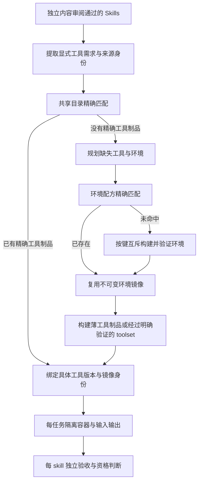

# 共享工具层：当前集成分支的演进设计

状态：2026-10-29 第一阶段已合入并验证：共享依赖环境、薄工具镜像、真实 RDKit 兼容性、失败隔离与并发。Open Babel run74 已在共享环境 hit 下完成完整 8/8 验收；五成功批次共 72/72，当前 647 OK (3 skipped)、三个自检全绿。精确 Tool resolver / toolset 制品共享仍只是设计，尚未实现；不能将环境共享外推为完整工具制品解析或全部 Skill 稳定性证明。

同主机共享范围已扩展：显式 CHEM_AGENT_SHARED_ENVIRONMENTS 绝对目录可跨工作副本使用，默认仍为各副本 .pipeline；缓存路径仅进动态回执，不进冻结输入。真实双 checkout/双进程公共脚本复验通过（1 次环境构建、2 个薄工具构建、第二进程 hit），结果 shared-registry-cross-checkout-20261029-02/result.json。该试验只验证跨目录共享，新的同键有界等待与双进程争用证据见下；完整 Tool resolver 尚未实现。

交付兼容性补验：全新安装/导入/迁移的两次原合同重验 16/16，迁移后的显式重建 8/8、共享环境 hit、仅 1 次薄工具构建调用。0 模型，原库资格与包/缓存记录不变。公开验证脚本及 fresh `-02` 证据见 [共享环境协议](../pipeline/shared-environments.md#verify-delivery-and-rebuild-compatibility)。这 24 条是已有合同的交付重验，不作为新增完整生成批次合入 72 条原始验收计数。

最新结论见 [current-acceptance-20261029.md](current-acceptance-20261029.md)，下面按阶段保留历史计数。只读 `runtime-shared-inspect` 可检查当前 daemon/image 身份或离线查看历史记录，不修改缓存、锁、镜像或资格。五个成功场景的原始结果、当前镜像及正式库资格均通过严格复核；复核不是新的业务执行批次。

run71 后最新组合回归为 **622 OK (3 skipped)**，三个自检与四来源封套 preflight 全绿。新增真实并发验证和后续 ToolArtifact 协议见本文末尾及 `../pipeline/shared-tool-artifact-protocol.md`。run71 的新安装命令形成不同 recipe，因而 built 而不是 hit；当前采用精确配方复用，未实现语义等价命令合并。Open Babel 该轮 11/12，唯一正则断言误拒末尾换行，整轮仍 failed。

run72 后最新组合回归 **628 OK (3 skipped)**，三个自检与五来源封套 preflight 全绿。该轮真实共享环境再次 hit b369a43e，正常文件断言和全部五条原生检查通过；两个额外错误谓词仍使整轮 failed（9/11）。精确 Tool resolver 继续保持“设计、尚未实现”的边界；正则正例一致性预检与原生预览标记已合入，并不跳过任何实际执行。

run73 后最新组合回归 **635 OK (3 skipped)**，三个自检与五来源 preflight 全绿。共享环境再次 hit，正则正例预检与原生边界说明实际生效，但旧等值比较的不可满足期望使整轮 8/9 failed。新增比较协议预检与实际回执汇总修复；共享不替代逐用例通过。当前缓存两份环境均 available/unlocked，元数据证据 shared-environment-current-status-20261029.json，不授予业务资格。

## 依据与目标

已阅读操作者指定的 `01a16963-6d7b-7982-b94d-5bd483659ad5` 对话本机记录，以及 `chem-agent-toolkit_newpipeline/reports/shared-tool-layer-design-2026-10-23.zh-CN.md`。那次讨论针对旧代码，本次以 integration_deepseekapi 当前实现重新核对。此前限制“不修改代码、不构建”是历史研究范围；操作者本次明确授权优化当前 pipeline。

目标是减少随 skill 数量重复发生的规划、依赖安装和环境构建，同时保留真实入口、冻结来源、隔离任务和逐 skill 业务验收。不是把全部 skills 塞进一个不断升级的环境。

## 决策

精确制品复用与批次需求去重不是互斥方案。采用：

第一阶段先实现环境共享和薄工具镜像，保持当前镜像内 package 字节校验、ENTRYPOINT、标签和安装包语义。它仍有轻量 build 调用，但不再为每个 skill 新装同一环境。第二阶段再增加规划前的精确 Tool resolver；不能把“共享环境”声称为已经省掉 planner 调用。

不先做自动兼容合并、常驻容器、计算结果缓存或受控代码挂载。这些分别涉及依赖/ABI、请求状态、科学输入语义、便携交付和镜像内源码证明，不能附带实现。普通独立工具打包约束仍保留；共享对象首先是执行器管理的环境制品，而不是允许作者访问任意 sibling skill。

## 当前代码接缝

| 模块 | 现状 | 接入点 |
| --- | --- | --- |
| `runtime/preparation.py:render` | 有 dependency_files 和 prefix_steps，随后 COPY 全部材料 | 只把声明的依赖前缀提取成环境阶段；不猜测任意 RUN 是否与源码无关 |
| `runtime/local.py:build` | 每修订调用 Docker build，核验镜像、入口、标签、package bytes | 构建前解析共享环境；最后的工具镜像仍经过同一套校验 |
| `runtime/preparation.py:prepare` | supplied plan 可跳过模型；否则 propose | 后续增加 request key 命中的具体已接受计划，重新校验当前契约 |
| `runtime/service.py` / `contracts.qualify` | 镜像和执行证据绑定当前修订 | 共享不传播其他 skill 的 passed 标记 |
| `artifacts/store.py` | skill accepted/candidates 与事务目录 | 继续管理 skill；环境缓存不是第二套 skill catalog |

## 三种身份，不混成一个哈希

1. **request_key**：规划前已知的工具源码摘要、显式需求、平台、相关策略版本。未来用于查找已接受的具体工具计划。无法确认完整需求就保守未命中；不依赖调用模型后才生成的信息。
2. **recipe_key**：固定 base RepoDigest、平台、环境变量、依赖文件的路径/内容/必要元数据、按顺序的环境安装前缀、renderer ABI。排除 skill 文案、验收 fixture、业务入口和 candidate ID；它只是构建请求身份。
3. **artifact_identity**：实际 Docker image ID + daemon ID，并记录 recipe_key。与 OCI manifest digest 是不同类型；本机镜像不假装成可跨主机拉取的 RepoDigest。

未固定完整依赖闭包时，允许复用已经保留且核验过的精确镜像，但标记 complete_rebuild_lock=false。不宣称相同 recipe 必定得到相同字节；需要刷新时创建新记录/版本，不原地升级旧 skill 绑定。

## 环境共享第一阶段的边界

- 只有 pin_base_image 已固定 digest 且明确 dependency prefix 的计划可参与。无前缀、依赖文件不安全、配方未解析的计划走原构建路径并记录未命中原因。
- 环境阶段只包含基镜像、环境变量、dependency_files 和前缀 RUN。工具阶段引用实际环境 image ID，再 COPY 冻结内容、执行剩余工具步骤、设置原 USER/ENTRYPOINT。
- 不能从共享环境继承另一 skill 的文件。固定默认 /opt/skill、依赖文件路径和相对安装语义；有业务文件依赖的步骤不能划入环境前缀。
- 命中时重新检查 daemon、image ID、平台和 recipe 标签；注册记录不可信或镜像消失则保守未命中。不能仅凭镜像 tag 命中。
- 按 recipe key 的本机文件互斥；完成构建并检查身份后才原子登记。构建失败/进程中断产生的半成品不登记；锁不靠固定超时强抢活进程。
- 不执行自动 GC，不删除旧环境、不更改 Docker 全局设置。动态缓存根不进入冻结交付内容。
- 每个 candidate 继续有自己的镜像标签、冻结构建请求、锁定用例与完整业务执行；缓存不是验收豁免。

## 后续精确 Tool resolver

具体接口、迁移与验收边界见 `../pipeline/shared-tool-artifact-protocol.md`。它是待实现协议，不是当前能力。

只有相同实现、接口、依赖要求与目标平台才能共用工具制品。不同工具可共享同一已验证环境；多个工具也可以组成独立版本的 toolset，但新增工具不能改变旧绑定。

为当前便携包保留自包含模式。跨 skill 直接共用同一个完整工具镜像，需要把 candidate 标签校验与工具制品身份校验拆开，并在 receipt 里同时记录两者；不能简单移除现有标签检查。代码包只读挂载模式另起协议版本，不在第一阶段暗中加入。

## 验证与度量

### 已完成五轮的实测切片（run69–73）

后续 run74 为 shared_environment.status=hit、8/8 passed。包含该轮的当前六轮机器切片为 `validation/deepseek-api/shared-phase-metrics-run69-74.json`：2 次环境构建调用、4 次 hit、6 个薄工具镜像，共 38 次准入调用（仅这六轮，不是整个会话总费用）。以下五轮表保留原切片范围，包含失败不会隐藏。

留存记录汇总 `validation/deepseek-api/shared-phase-metrics-run69-73.json`：

| 轮次 | 准入调用 | 环境阶段 | 执行记录 passed/total | 整轮 |
| --- | ---: | --- | ---: | --- |
| 69 | 10 | built | 6/9 | failed |
| 70 | 4 | hit | 5/11 | failed |
| 71 | 7 | built（不同精确配方） | 11/12 | failed |
| 72 | 5 | hit | 9/11 | failed |
| 73 | 6 | hit | 8/9 | failed |

共 2 次共享环境构建调用、3 次 hit、5 个独立薄工具镜像。五轮构建均成功，失败保留在各自业务/检查契约结果，环境复用不传播 passed。此表不把未全通过的批次计为验收成功，也不把 32 次准入调用当作整个会话的开销；它只覆盖这五轮。详细结构化回执的实际模型、原始 token 与耗时保留在机器记录，旧 summary 的错误原生模型标签不作为依据。

构建调用次数不代表安装命令真正重跑次数：Docker 自身层缓存也可能命中。这里没有基线对照的速度/磁盘节省比例，没有供应商全部重试 token 或完整费用结论。结合逐轮错误内容，可判断当前收尾重点是检查/契约生成与预检；不能因镜像复用已证明就声称所有业务验收通过。

至少验证：同配方两个不同工具共享环境；文案/fixture 更新不重建环境；base/依赖/平台/安装顺序变化失效；镜像缺失、标签漂移、daemon 不同、目录记录损坏不能命中；同键并发只登记完整产物；失败不会登记；旧绑定仍能执行；两份独立业务结果与资格保持正确。

分开报告 planner 调用数、环境 build 次数、薄工具 build 次数、实际安装输出和每 skill 测试数。Docker 层可能本来就已命中，不能把镜像虚拟大小相加当成实测节省。共享 worker 与结果缓存收益不计入本期。

## 核实的官方资料

- [Docker cache invalidation](https://docs.docker.com/build/cache/invalidation/)：缓存按指令与相关 COPY/ADD 输入失效；RUN 的缓存不会自动追踪远端索引更新。
- [Docker cache optimization](https://docs.docker.com/build/cache/optimize/)：稳定依赖步骤应位于易变源码之前，保持环境构建上下文小。
- [Docker storage drivers](https://docs.docker.com/engine/storage/drivers/)：共享镜像层与容器自身写层分离。Engine 29 新安装可能使用 containerd image store，不能套用旧 storage driver 的磁盘统计方法。

此前报告中的学术工作用于架构背景；本次没有重新宣称其历史性能数据能直接适用于当前 pipeline。实施结果与实测数字后续补入。

## 第一阶段实现与当前验证

独立工作树 `chem-agent-toolkit-shared-runtime-20261029` 开发，未改动同时运行的 run68。新增 shared_environment.py：renderer 冻结显式依赖前缀；LocalExecutor 在同一 build deadline 内解析共享环境、构建薄工具镜像，沿用原镜像入口、标签和 package 字节验证。环境记录是本机优化缓存，不替代 skill catalog 或业务通过证据。

首次真实基础设施测试目录 `shared-environment-infrastructure-20261029-01` 失败：BuildKit 将 `FROM sha256:<本机 image ID>` 解释为 `docker.io/library/sha256:<tag>`，发生 pull access denied。不能把配置 image ID 当 OCI reference。修复为内容寻址的本地 transport tag，使用前核验 tag→image ID，并检查最终工具镜像的 RootFS 层前缀与所选环境一致；不可变身份仍是 image ID + daemon ID。

第二次全新目录 `E:\Users\27343\Docker\shared-environment-infrastructure-20261029-02` 实测通过，result.json 记录：environment_builds=1、thin_tool_builds=2，第二个工具 status=hit，两个工具输出各自身份并读取同一环境探针。此试验没有模型或化学执行，网络关闭，只证明真实 Docker 共享机制，不冒充科学业务回归。命令回执逐次落盘，失败也保留。

首版全量 593 OK (3 skipped)，新增传输标签/层身份回归后正在全量重跑。初步 9 项测试已通过；最新计数以最终日志为准。共享功能尚未合回主分支，精确 Tool resolver 尚未实现。

历史成功计划也揭示 planner 的复用布局问题：run59、64、65 把仅需依赖文件或完全不需源码的 pip install 放在 COPY 全文之后，而 run62 已使用 prefix_steps=1。下一步在不改业务契约的前提下明确依赖前缀规划规则，仍由模型声明，不从任意 shell 命令自动推断可重排性。

最终离线验证：596 OK (3 skipped)，日志 E:\Users\27343\Docker\shared-environment-phase1-final-tests.log；三个自检绿，相关专项 44 项通过。第一阶段已通过独立工作树验证；合回主分支后还须组合回归。精确 Tool resolver 和真实化学工具在共享模式下的业务复验仍待完成，不能据基础设施试验宣称这些已实现。

## 合入主分支后的验证

共享实现已合入 pipeline-with-docker（ca478a6），与 run68 的草稿修复补丁组合后，全量 599 OK (3 skipped)，三个自检绿。日志 acceptance-run69-combined-preflight-tests.log。

真实 RDKit 两工具试验 E:\Users\27343\Docker\shared-rdkit-two-tools-20261029-01/result.json 已通过：1 次环境构建、2 个薄工具镜像，第二个命中同一环境 ID；4 条业务检查通过（乙醇 MW 46.069/供受体数、非法 SMILES 拒绝、离去基团 maps=[3]、重复 map 拒绝）。两个原脚本字节不变，依赖使用描述符原 pins；0 模型调用，化学执行仅在网络关闭/只读/非 root 容器中。此为共享环境兼容性试验，不冒充新增 skill 生成批次，也不证明所有 RDKit 工具兼容。

精确 Tool resolver 仍待实现；本期已实现的是跨 skill 构建共享依赖环境，不能把它称为已经消除模型规划。旧 skill 镜像和历史资格未被修改。

后续收尾已合入：同时核验环境层、ENV 和 WORKDIR；明确 context-relative script 与 absolute container entry hint；用途错误反馈列出声明值/实际值/用例名。真实 Docker metadata 继承试验 shared-environment-infrastructure-20261029-04 通过；失败隔离试验 shared-environment-failure-isolation-20261029-01 证明新构建失败不登记且旧 RDKit 仍正常计算。共享构建非零退出保留为 build_failed（环境修复路径），锁忙等保持 runtime_blocked。组合最终 609 OK (3 skipped)，三个自检绿，日志 acceptance-run70-final-preflight-tests.log。

历史并发实测 `E:\Users\27343\Docker\shared-environment-concurrency-20261029-02/result.json` 通过（当时的脚本 `verify_shared_concurrency.py`）：首请求持锁期间，第二个同键请求明确 busy，不能消费未完成条目；完成后第三个请求 hit。只有 1 次环境构建、2 次薄工具构建，两个独立、无网络、只读、非 root 容器正确输出各自工具身份和同一环境标记。0 模型、0 化学计算；该历史试验不能称为自动等待或同时请求全部自动成功。

## 同键并发请求合并（21:18）

冷缓存下第二个 Skill 完成模型工作后若直接 busy 停止，会要求操作者重试。现在改为在既有 build deadline 内等待持锁者完成，拿到锁后重新核验记录、daemon 和镜像；完成则 hit，前者失败未发布则可接手构建。不会读取 partial，也不重复并发构建；等待/取消/超时不删除其他所有者的锁。崩溃遗留锁不按年龄强抢，仍须显式恢复。动态回执增加 waited_for_builder，不修改冻结配方、业务断言或模型预算。

额外修正一个原有超时边界：共享准备完成后，若预算已耗尽，不启动薄工具构建。等待与环境/薄镜像共用原截止时间；不是新增隐含时长或持久任务调度。四项新增回归覆盖完成后复用、前者失败后接手、取消不动别人的锁、预算耗尽不启动构建，原崩溃锁测试强化为超时后锁内容不变。

真实线程争用试验 `shared-environment-wait-20261029-01/result.json` 与真实双工作副本/双进程试验 `shared-registry-concurrent-checkouts-20261029-01/result.json` 均通过：实际观测第二请求 exclusive-file collision、无完成记录，然后放行第一构建；两个原始请求自动完成，built/hit，同一环境 image/key，仅 1 次环境构建、2 次薄构建，两隔离容器输出各自身份。0 模型、0 化学/依赖下载，不增加五个生成批次的 72 条业务计数。测试协调钩子只存在于验收脚本。没有实现公平队列、崩溃锁自动接管或完整 ToolArtifact resolver。
