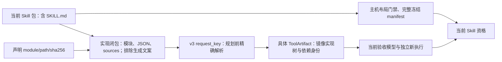

# 有限文件相对 JSON 资源：shared_tool_image_v3

2026-11-02：v3 的真实公开 CLI 安装/envelope 与原生输出导入/路径迁移/恢复已补验，
12 个独立 attempt 共 192/192；导入与迁移先撤销执行资格，故障和漂移不污染旧绑定。
支持边界、明确的镜像缺失注入与失败辅助轮见 [交付恢复证据](../integration/v3-delivery-cli-20261102.md)。

新增能力是已声明的、由模块 `__file__` 锚定的固定 JSON 读取。多模块 Python 和包内数据
原本就会进入完整闭包，不算本次新增。v1 对任何 `__file__` Name 节点仍拒绝；v2 Open Babel
协议保持原边界。实现为 `runtime/bundled_data.py`，接入 shared_tool 的 describe、记录验证、
冻结绑定复核和 inspect；不改变 planner、执行器、独立审阅、覆盖或资格门禁。

仅当 policy=`closed-python-json-data-v1` 才选择 ABI=`shared_tool_image_v3`。新声明保留
closure/requirements/interface/platform/policy，另须提供 `bundled_data` 非空列表：

```json
{
  "module": "scripts/triage.py",
  "path": "scripts/data/rules.json",
  "sha256": "<该文件原始字节的64位小写SHA256>"
}
```

该片段不是完整 declaration。module/path 均相对包根、精确区分大小写、安全且不含链接；
module 必须为 .py，path 必须为 .json。实际文件存在、原始 SHA256 相同且能按 UTF-8 JSON
解析，才能生成请求。每个声明必须由该模块使用，重复 module/path、缺文件或未用声明拒绝。
当前范围内读取形式为：

```python
from pathlib import Path
payload = (Path(__file__).resolve().parent / "data" / "rules.json").read_text(encoding="utf-8")
```

也可用一个字面量 `"data/rules.json"`。不支持 Path 别名/重绑定、路径变量、中间 Path 变量、
parents 索引、`..`、绝对路径、read_bytes、其他编码、写操作、`__file__` 其他用途、反射式
Path 绑定或通用动态加载。Path Name 仅可出现在识别出的固定读取表达式中。源码字符串引用
被排除的 SKILL.md、v1 禁止的执行/加载行为仍拒绝。无法匹配有限形式时具名拒绝，不猜兼容。
这是显式有限协议及源码形态门禁，不是任意 Python 程序的完整静态分析或安全证明。

固定资源属于**工具实现闭包**，不属于外部 resource_refs/挂载。模块、其他支持源码、数据和
完整 sources 均按原 path/sha256/bytes/mode 纳入 request；声明及数据预期 hash 也进入 request。
当前接口仍限定 `/opt/skill`、resources=[]、runtime_network=false、Linux/amd64，依赖必须显式
声明 imports 版本和空 executables。任意 subprocess、动态 import、外部文件资源均未新增支持。

编写和独立审阅的 host context 会自动给出 `tool_execution_layout`：完整当前 Skill 包由 host
冻结布局门禁核验，共享工具镜像的 package 不含当前 SKILL.md。该信息不是业务 oracle，
也不表示已执行。原生检查必须保留实现文件 hash、规则值及业务义务，但应核验正确对象，
不把完整 Skill 的文件集误当作 ToolArtifact 镜像文件集。普通配置无需手工加入协议来源。
异常处理、模式匹配或属性赋值重绑定 Path/__file__ 亦拒绝，不把它们当成固定 pathlib 来源。



首建/命中都继续验证当前冻结包和来源、入口映射、两份镜像工具树以及实际依赖版本。
只读非 root 容器执行当前 Skill 的锁定合同；JSON 正确性、输出语义和业务资格不由资源 hash
自动证明。命中依旧必须独立审阅、当前验收专用模型和新 ExecutionAttempt。

修改模块/数据/依赖声明/接口使 request 改变；只改数据而不更新声明 hash 先报
`shared_tool.bundled_data.<path>: expected sha256=...; actual=...`。更新声明 hash 后是新请求，
不能命中旧版本；显式指定旧版本时 select 返回 selected_request_mismatch，不换版本。
未声明读取指出 module、预期 declared path 和实际 target；缺文件指出具体路径及 missing_or_linked。

ToolArtifact 外层字段仍为 v1 那组（无 v2 的 external_identity），recipe_key/artifact_id 算法
不变，ABI/声明差异进入身份。SkillBinding、RuntimeRequest 与 delivery protocol 2 字段不变。
旧 v1/v2 保持读取和校验，v3 不能被降级为 v1；旧客户端不认识 v3 应拒绝而不是剥离声明。
没有远端仓库、OCI 分发、自动依赖合并、结果缓存或平台数据库迁移。

真实 CLI 例子、测量口径、失败轮及最终结果见
[P2 验证报告](../integration/bundled-json-tool-20261101.md)。新样例是在独立来源目录中组合
原描述符计算模块（原字节）和新筛选入口/规则，不声称历史来源原先已具备该入口。
