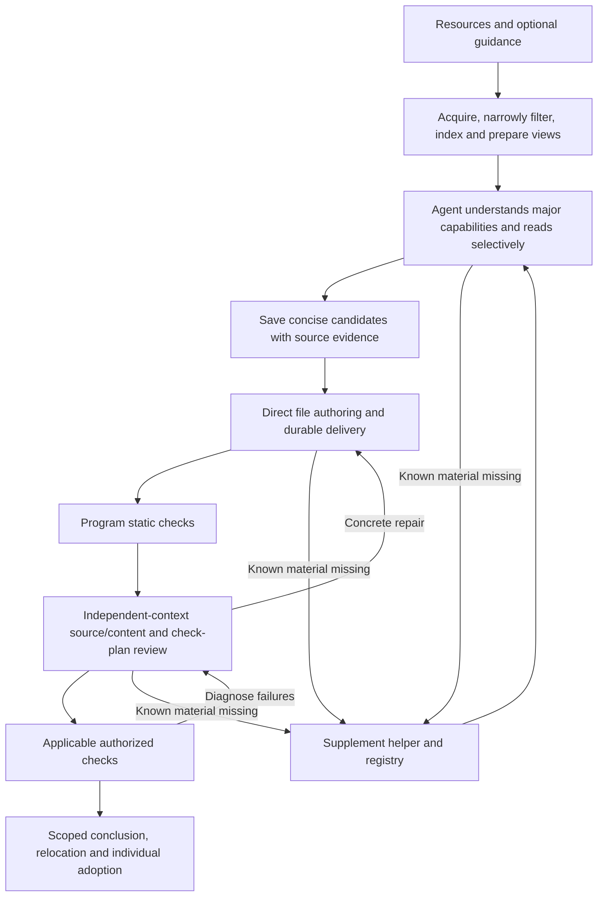

# Design

Codex CLI is the only public execution path. Native file/shell/image tools remain available. The first candidate continues discovery; later candidates have isolated sessions; repairs reuse the candidate session and review has its own session. A continuous session is not permanent memory or guaranteed cost savings.

Production has no implicit model time/turn or output-count quota. Development uses explicit presets/overrides. Confirmed no-progress failures can stop; repeated successful reads are not killed by count alone. Original resources and helper views remain available, and known supplements join the same registry. No manual plan edit/approval gate is required. Internal plan records remain for audit and recovery.

## Candidate and delivery

Agent-facing candidates describe capability/boundary, value, key use path, construction, evidence and gaps. Host constants and compatibility fields are normalized internally. No fixed auxiliary file list or test-command quota at discovery. Candidate records can be saved incrementally; selected saved names must be explicit. One blocked candidate does not block the rest.

Author writes actual files and optional check/issue metadata. The finish helper computes hashes and atomically records a completion receipt bound to the candidate/feedback token. Final Agent reply is small. A valid receipt can recover delivery even when the final JSON is missing; mere SKILL.md existence cannot. Binary support files and empty Python package initializers are possible. coverage quotations are not produced or required. Source-supported scope updates and additional candidates can be recorded, reviewed and queued without human approval.

## Checks and feedback

Program checks structure, supported syntax, links, paths and integrity. Review gets the same minimum/packaging standards, original-source access and tool helpers. It reviews test plans before execution and may run approved diagnostics through the shared check helper. Logged checks can be reused when their definitions and exact package files match. Unknown execution conditions are not invented successes.

There is no blanket execution of every code block or script branch. Tests target actual delivery and a source-supported oracle. Applicable business checks use the integrated Docker preparation/build/execution stages; native commands use a workspace sandbox plus an execution instruction, not a host filter for every command. See [Docker execution](docker-execution.md) and [delivery protocol](delivery-protocol.md) for formal qualification.

Failures distinguish actual defects, check invocation issues and possible external conditions. A possible missing-module diagnostic remains a failure until review confirms an external prerequisite rather than a missing delivered module. Timeouts are unverified operations. Unavailable runtime alone is not a blocking content defect. ready means applicable review passed with no known blocker, not all tools or science verified; unverified scope stays in records/catalog.

## Recovery and records

Each native turn persists session, non-reasoning events, receipts and result. Source registry and completed deliveries survive incomplete turns. Resume validates sources/specifications, reconciles supplements and reuses finalized files. It re-enters stage boundaries, not exact inference instructions. Historical pre-v5 checkpoints may require a new build with cached resources. Optional rediscover permits changed specifications. No concurrent resume of one run.

One failed candidate does not block others. Scope changes and sources update internal plans; candidate names and library collisions do not overwrite existing skills. Retain input, sources, decision, final checks and necessary diagnostic records. Successful temporary work can be cleaned; failed runs retain recovery material. Cache cleanup is separate.

## Modules

The entry point is `python -m creation_pipeline`. Internal modules use responsibility-based packages. Native content sessions and tool-free structured runtime calls both use Codex CLI; they have different configuration policies. See [code organization](code-organization.md) for the full tree and dependency boundaries, and [transport diagnostics](configuration.md#tool-free-model-transport-diagnostics) for completion and cleanup guarantees.

- pipeline: stage orchestration, partial continuation, scoped conclusion and recovery.
- models/cli/schemas/records/paths: configuration, commands, Agent result records, durable records and stable paths.
- resources: acquisition, snapshots, document views, original-file locators and supplements.
- agent: Codex CLI discovery, native sessions/events and a thin helper command router.
- generation: candidate decisions, prompts, handoffs, direct-file writing and review coordination.
- validation: deterministic checks, explicit check execution and recorded Agent diagnostics.
- artifacts: file manifests, delivery receipts, installation and library adoption.

Deterministic test doubles live only under tests/pipeline/support.py. They simulate Agent decisions and file writes through the same delivery helpers as production; they do not require a second production backend.
