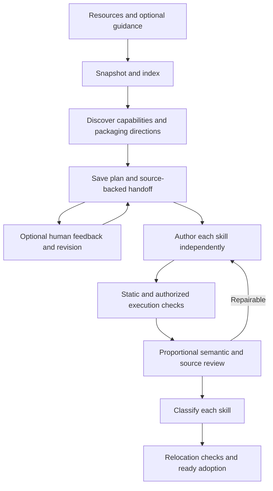

# Design

Discovery combines utility reasoning and planning; zero candidates is valid. Existing research behavior is packaged, not invented. Scripts belong inside a skill; independent tools/shared dependency graphs are unsupported. One coherent capability can call several existing tools.

## Context and continuation

Calls are independent. The host supplies stage context and on-demand read history. Discovery handoff facts cite actual read IDs; author context isolates candidates and preserves guidance, notes, constraints and key evidence. Review receives source evidence, final files, checks and issues, not hidden reasoning. Summaries never replace original evidence. The host caps assembled context in characters, omits oldest read results with an explicit notice when necessary, and never drops the fixed candidate/evidence context silently. Oversized fixed context fails with a request to narrow scope. Original read evidence remains recorded. Directory search locates passages; only actual reads create citation evidence.

Plans preserve source snapshots and specification hashes. The lock fingerprints source context, not a server session. Revision saves a new plan plus parent and human feedback, without modifying the original. Candidate fingerprints control ready-file reuse; reuse is not fresh verification. Critical context/specification changes require rediscovery. Missing source evidence remains explicit.

## Files and verification

Models return complete files, coverage quotations, tests, issues and notes. Host writes file bytes verbatim; quotations locate minimum content but do not prove correctness. All skills receive semantic review. Blocking issues or missing review evidence prevent ready. Failed generated assertions cannot silently disappear/change expected results. Tests run with bounds and filtered environment, not an OS sandbox. Sources and files must remain immutable.

Before adoption, checks rerun with a relocated package. Engineering readiness is scoped to evidence/checks and is separate from scientific validity and Agent benefit. Known-address downloads are supported; general search/vision are deferred.

## Code map

- models/schemas: configuration and response contracts.
- acquisition/documents/intake: download, text views, snapshots and evidence.
- context/analyze: stage handoffs, discovery and revision input.
- author/prompts: direct writing, repair and review.
- checks/runtime: static validation, actual execution and assertions.
- pipeline: budgets, sequencing, continuation and state.
- package/library/records: integrity, adoption/catalog, records and cleanup.
- model_backend/providers: mediated model actions, CLI/API transports.
