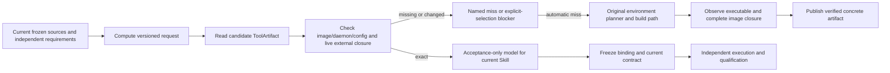

# Open Babel external-tool identity protocol

`shared_tool_image_v2` with policy `openbabel-debian-image-v1` extends exact local
tool reuse for the original fixed-argv Open Babel Python conversion wrapper.
The existing `shared_tool_image_v1` / `closed-python-bundle-v1` remains supported.
Neither mode distributes OCI artifacts or grants a Skill another Skill's qualification.

The caller supplies the same independent tool declaration and runtime requirements
for both Skills; only their documentation style differs. A minimal new declaration is:

```json
{
  "closure": "all-package-and-sources-except-skill-document",
  "requirements": {
    "imports": {},
    "executables": [{
      "name": "obabel", "path": "/usr/bin/obabel", "version": "3.1.1",
      "package": "openbabel", "closure": "debian-image-rootfs-v1"
    }]
  },
  "interface": {
    "entrypoint": ["python", "/opt/skill/package/scripts/convert_molecule.py"],
    "workdir": "/opt/skill", "resources": [], "runtime_network": false
  },
  "platform": "linux/amd64", "policy": "openbabel-debian-image-v1"
}
```

The declaration is passed as `runtime_defaults.shared_tool` (or per candidate).
The CLI validates it before generation. No caller-provided plan, acceptance_plan,
package version inventory or hand-authored artifact record is needed.

The adapter checks the complete Python AST against the supported original wrapper.
Comments and formatting can differ but still change the byte-level request key.
Shell invocation, arbitrary subprocess programs, additional Python helpers and
changes to this wrapper's semantics are unsupported. This is a finite adapter,
not a general proof that Python's subprocess or dynamic loading is closed.
The byte-identical source binding and complete package/source manifest remain required.

`request_key` covers the caller's upstream executable version and path, executable
package/closure policy, interface, source/package bytes, requirements, platform,
constraints and limits before planning. It does not contain an invented installed
version. `recipe_key` continues to identify the actual installation plan and pinned
base. `artifact_id` includes the actual image/daemon plus the observed `external_identity`.
Local Docker image IDs continue to be local identities, not OCI manifest digests.

The additional observation records:

- Resolved executable path and real path, SHA256, exact `obabel -V` output and dpkg owner.
- The complete dpkg package/version/status inventory, including Debian revision suffixes.
- Resolved `ldd` libraries and their real paths/SHA256; unresolved libraries fail.
- Standard Debian plugin/data directories, which must exist and be nonempty.
- A canonical SHA256 over the entire image filesystem inventory: regular file
  bytes, size, mode, uid/gid; symlink target and metadata; and directories.
  This conservative superset covers plugin ELF dependencies, loaders, configuration,
  data files and Python/system support beyond just the executable's direct `ldd` list.
  The inventory is recomputed live; the artifact stores its digest, counts and byte sum.
- The exact observer program SHA256, so an old observation cannot silently survive
  changed observer semantics. Future closure semantic changes require a new protocol.

Docker runtime mounts (`/proc`, `/sys`, `/dev`, `/run`, `/tmp`, `/etc/hosts`,
`/etc/hostname`, `/etc/resolv.conf`, `/.dockerenv`) are explicitly excluded.
Image `/run` and `/tmp` must contain no files or symlinks. Image volumes and BABEL_*/LD_*
loader overrides are unsupported. Executable/library dependencies cannot resolve
into excluded runtime paths, and plugin/data directories must be canonical image
directories. No runtime mounts or credentials enter the probe.
The finite wrapper uses the image's standard plugins/data; arbitrary plugin locations
and runtime-installed plugins are unsupported. File/ABI equivalence is never inferred.

The probe is a short-lived, read-only, network-isolated container. Root plus
`DAC_READ_SEARCH` is used only for complete metadata/file reads (including private
APT directories); all other capabilities are dropped and no-new-privileges is set.
No conversion or installation runs in this probe. `obabel -V`, dpkg-query and ldd
are metadata observations. Business cases retain non-root UID/GID 10001, the existing
read-only/no-network limits and independent output directories. Probe cleanup is
owned by its unique container name on success, error, timeout and cancellation.
Owned cleanup retains a separate bounded ten-second allowance even if the build
deadline has expired; this never permits another build or another model request.

Only after all ordinary image/content checks and the live external observation agree
can the artifact be atomically published. On a later request, the same observation
runs before selecting the artifact, before/after business validation and during current
qualification. Missing executable/package/plugin/data, a closure mismatch, a changed
observer, daemon/image loss or an invalid record cannot yield a trusted hit.
The next Skill compiles its own acceptance using the existing acceptance-only model;
its independent author/reviewer and all source/coverage/qualification gates remain.

Plan checks also run inside the existing planning-feedback loop before freezing.
For this adapter, `--output-format sdf` plus a retained output file cannot use a
JSON/JSONL artifact assertion or capture_stdout that overwrites that file. The
compiler must assert the actual SDF with source-grounded text_regex and keep JSON
stdout metadata checks separately. This diagnoses an observed failed interface
case; the runner's output-channel selection and comparators stay unchanged.
During a channel correction, existing cases cannot be deleted, valid other cases
cannot be changed, and the affected case retains its layer, oracle status,
purpose, argv, fixtures, expected exit, output file and stdout checks. The current
draft's protected cases remain available in feedback so correction needs no
manual reconstruction. Repeated failure or exhausted budgets still blocks.

The acceptance-only model also receives `observed_tool_identity`: the verified
artifact ID and executable metadata, including the complete version_output.
It contains no old tests, business outputs or passed flags and cannot be changed
by the model's four-field acceptance response. Probes still execute independently.
For the recognized direct Python JSON metadata probe, a closed quoted short
version (for example `"Open Babel 3.1.1"`) cannot match the raw version with its
build suffix. A preflight diagnostic requests the required version plus a space
boundary. Correction retains the exact probe program, Python-series/path checks,
expected exit and every other case; banner-only checks and dropped probes fail.
Other probe programs are not guessed at and still require actual execution.



Open Babel's upstream documentation explains why plugin/data and loader settings
must be part of the compatibility boundary:
[installation environment variables](https://openbabel.org/docs/Installation/install.html),
[project installation source](https://github.com/openbabel/openbabel/blob/master/INSTALL).
The complete-image policy and finite wrapper restriction are this project's
conservative design, not an upstream guarantee of arbitrary dependency closure.
