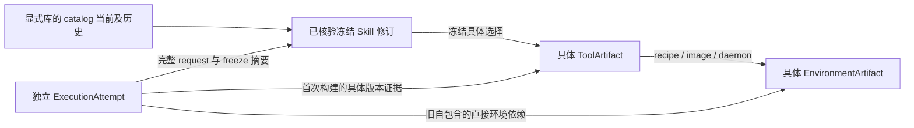

# 只读反向引用协议 v1

入口为 `python -m creation_pipeline manage REQUEST.json`，操作 `references.query`。
沿用 `chem-local-management/v1` 封套；data 协议为 `chem-references/v1`。实现位于
`creation_pipeline/references.py`，Python `query(params)` 返回 `(data, evidence)`，也可通过
已有 `management.dispatch` 获得完整封套。旧六个管理操作和原 CLI 参数不变。

查询回答具体工具版本的 Skill 修订/冻结绑定、具体环境的工具版本，以及相关依赖绑定和 attempt。
结果是文件中的依赖事实，不是“制品现在不可用”的判断，更不是删除许可或资格结论。



## 必须显式指定范围和具体身份

```json
{
  "api_version": "chem-local-management/v1",
  "request_id": "refs-001",
  "operation": "references.query",
  "params": {
    "libraries": ["E:/operator/library-a", "E:/operator/library-b"],
    "tool_registries": ["E:/operator/shared-tools"],
    "environment_registries": ["E:/operator/shared-environments"],
    "target": {
      "kind": "tool",
      "request_key": "<64小写hex>",
      "artifact_id": "<64小写hex>"
    }
  }
}
```

占位符须换成真实值。三个目录数组均必需；允许空数组，含义是**未扫描该类目录**。只允许
绝对无链接路径，各数组内不能重复；不使用 `.env`/环境变量指定的默认共享目录，也不自动
搜索兄弟工作副本。不存在的目录形成扫描诊断，不创建空库或共享目录。

环境目标替换为：

```json
{
  "kind": "environment",
  "recipe_key": "<64小写hex>",
  "image_id": "sha256:<64小写hex>",
  "daemon_id": "<已观察到的本机daemon身份>"
}
```

工具身份是 request_key + artifact_id，不能只给 request_key 或镜像 tag。环境身份是依赖
recipe_key + image_id + daemon_id；同一配方重建出不同镜像/daemon 不合并为同一实际环境。
这是现有 EnvironmentArtifact 观察的具体身份，不新增伪造的 OCI digest；本机 image ID
也不是 OCI manifest digest。工具的 recipe_key 与依赖环境的 recipe_key 不互换。

## 扫描和确定性关联

| 输入 | 读取的范围及关联 |
| --- | --- |
| library | v2 catalog 当前修订及 history；`evidence/<candidate>/<version>` 的全部冻结快照；`runtime/<candidate>/<attempt>` 的全部 attempt，包括 catalog 未列出的目录；catalog 指向的缺失对象也报告 |
| 冻结快照 | freeze manifest、record、revision 指纹、versioned 内容摘要及 shared_tool 原有静态绑定检查；冻结输入树内的文件只用于完整性核验，不执行源码 |
| ToolArtifact | 共享目录直接发布的 JSON 以及冻结/receipt 内嵌的具体记录；复用 shared_tool.validate_record，校验文件名、请求、配方和 artifact_id |
| EnvironmentArtifact | 共享目录直接发布的原生 recipe v1 记录，校验内容、文件名和具体镜像/daemon；与工具内嵌 environment 的具体三元组关联 |
| ExecutionAttempt | receipt 的完整 request 身份、冻结摘要、build-log 摘要、report 的 request/image/tag，以及 catalog 已记录的 attempt manifest；不依据 passed/accepted 过滤引用 |

catalog 只允许上述相对 evidence/runtime 布局；绝对路径、`..`、链接和未知布局报告诊断，
不会沿记录中的 registry、来源或旧机器路径访问外部目录。accepted/candidates 活跃包目录、
安装信封、原生 output、preparations/诊断目录不用于发现绑定；这些路径没有隐式适配。
活跃包漂移和业务通过与否仍属于原资格检查，不能由反向引用结果代替。

首次构建时冻结 shared_tool 可能只有请求，没有具体 artifact；这时必须由同一冻结身份的
完整 build receipt 提供具体工具版本，且请求、具体配方、镜像和冻结选择均一致，才能建立关联。
有冻结具体选择的修订，即使尚未执行或执行失败，仍有该具体版本的依赖引用。
旧自包含模式 receipt 的 shared_environment 可形成直接环境依赖，但不会伪造 ToolArtifact。

delivery/freeze/tool ABI 是协议版本；`inputs.bindings/environment/acceptance` 的 version 是原
preparation.rebind 递增的内容修订计数，合法正整数及其摘要继续核验，不能误判只支持计数 1。
未知 delivery/freeze/工具或环境协议仍按原校验器拒绝或报告，不猜测兼容。

## 返回结构和不确定性

成功封套的 data 始终包含以下字段；顶层 evidence 沿用 path/kind/sha256，摘要来自实际读取
的记录字节。缺失/拒绝读取的记录摘要为 null；不复制原始源文件内容到响应。

| 字段 | 含义 |
| --- | --- |
| protocol, observed_at, target | 本次派生观察版本、UTC 时间、完整目标身份 |
| scope.requested / roots | 精确输入数组、各根的实际遍历状态；局部读取失败也保留其他根的结果 |
| scope.unscanned_categories | 显式空数组的类别，不表示该类没有引用 |
| scope.complete_within_declared_layouts | 所声明布局内没有损坏、待发布、锁/事务或未确定绑定；不是全主机完整性 |
| scope.global_complete | 始终 false：其他库和共享目录未扫描，不能据此称“没有引用” |
| scope.layouts / not_scanned | 当前支持的目录布局和明确排除的输入形式 |
| target_registration | found_in_scope / not_found_in_scanned_roots / not_scanned，附已验证路径及所查找的具体文件路径 |
| matches.tools | 符合工具/环境目标的具体 ToolArtifact，含 recipe/image/daemon、environment_reference、登记路径、观察来源及证据 |
| matches.bindings | 已核验冻结身份的具体依赖关联，含库/name/candidate_id/revision_id/freeze_sha256/freeze_path、tool/environment_reference、catalog_roles、attempt_paths 和证据 |
| matches.attempts | 与上述关联相连的具体 attempt 路径及 request 身份，历史 build/report 状态明确标为 recorded；有具体工具观察还是只有冻结要求也明确区分 |
| unresolved_bindings | 无法确定的绑定；包括有效请求尚无具体版本、损坏/缺失冻结记录的 catalog 声称。后者标 catalog_claim_only=true，不混入确认匹配 |
| issues | 原始错误及 code/path/field/expected/actual/reason/evidence，不因其他记录可用而忽略 |
| index | 本次观察的工具/环境/绑定/attempt 数量；storage=ephemeral_rebuilt_each_query |
| interpretation, availability, qualification | 解释边界；后两项始终 null |

binding_id 是由具体库、冻结路径/身份和工具/环境版本派生的查询关联 ID，不是新增持久化
SkillBinding 协议，也不替代原 binding fingerprint。相同修订在不同库的副本保持不同路径记录；
catalog_roles 为空表示已扫描到但 catalog 未列出的冻结快照，不将其当作当前 Skill。
索引计数覆盖本次所有观察对象；matches 仅投影目标。unresolved/诊断保守覆盖整个指定范围，
有些损坏对象无法判断是否与目标相关，不能通过过滤掉它们来制造“无引用”的结论。

请求形状/身份/越界根无效：管理封套 request_invalid，exit 2，不开始扫描。
记录问题是成功完成的**部分观察**：ok=true、exit 0，必须检查 scope/issues，不能把 exit 0
解释成“所有引用已找到”。诊断 code 包括 record_missing、record_invalid、linked_path、
unsupported_layout、catalog_reference_mismatch、catalog_pending、publication_pending、scan_changed、
tool_record_not_found_in_scope、environment_record_not_found_in_scope。

损坏 registry 不抹除可验证的冻结/receipt 内嵌具体引用，但明确缺少匹配登记；损坏冻结内容
不能形成确认绑定，只保留未核验的 catalog 声称及错误路径。重复查询总是重读，可重建派生
索引；没有本机索引文件、缓存命中或旧扫描结果授信。

## 严格只读与影响解释

不调用 store.get/reconcile/recover/locked、qualify、executor 或模型；不获取、更新或删除锁，
不改资格和原记录，不创建/删除/探测容器或镜像，也不登记新制品。side_effects 只有
filesystem_reads=true，其余原管理接口标志均为 false。持有者锁、事务和 `.json.tmp` 等只
作为不完整观察诊断，不读取临时制品内容、不抢锁、不等待构建。

读取后复核目录成员、记录摘要与已核验冻结树，发生变化标 scan_changed；不重试或加锁。
这仍不是跨目录/跨进程原子快照，也不能排除任意对抗性文件系统竞态；面向本机受信操作者。
引用意味着潜在依赖影响，不保证每个绑定当前可用/不可用或合格/不合格。尤其依赖环境的登记
或独立镜像丢失，**不等于已派生的工具镜像必然无法运行**；当前可用性与资格须另走已有接口。
本轮不实现删除、GC、安全删除判定、远端目录、HTTP、平台或多租户服务。
