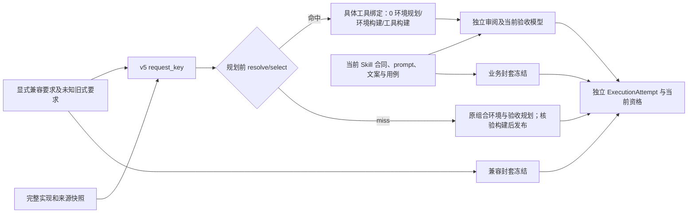

# 工具兼容要求与当前 Skill 合同

新版为显式 opt-in 的 `shared_tool_image_v5` / `request_protocol=2`。
它改变请求的要求作用域，不增加工具结构支持。implementation_abi 保留 v1/v3/v4 的 Python
实现语义；依赖、入口、固定 JSON 和平台仍按原规则验证。Open Babel 外部身份暂保留原 v2
请求路径，新作用域对它报 scoped_tool_profile_unsupported，不降级或剥离 executable 要求。

## 两个调用方字段

在 runtime_defaults 或具体 runtime 设置中同时给出 shared_tool、tool_compatibility、skill_contract：

```json
{
  "tool_compatibility": {
    "version": 1,
    "source_policy": "complete-snapshots-v1",
    "requirements": {
      "base_image": "python:3.11-slim-bookworm",
      "language": "python",
      "language_version": "3.11"
    },
    "constraints": {
      "dependency_files": ["package/requirements.txt"],
      "install_commands": ["python -m pip install --no-cache-dir -r package/requirements.txt"],
      "environment": [
        {"name": "PYTHONDONTWRITEBYTECODE", "value": "1"},
        {"name": "PYTHONUNBUFFERED", "value": "1"}
      ]
    }
  },
  "skill_contract": {
    "version": 1,
    "requirements": ["保留当前来源的业务输出、正常与非法输入义务。"],
    "constraints": ["按当前操作者文案组织说明，独立编制和执行验收。"]
  }
}
```

这是作用域片段；完整可运行配置见 validation/scoped-contracts/skill-a.json 和 skill-b.json。
不提供 plan/acceptance_plan；发现、编写、独立审阅和当前验收模型均照常执行。
新作用域是调用方选择的契约，不由模型从任意自由文本推断。配置中未知字段/版本/来源策略
直接具名拒绝。工具需求须放入明确兼容字段或保留为未分类要求；不能靠给真实运行需求换标签
使其消失。当前 Skill 的额外业务能力仍需来源、独立审阅及真实执行证明，不能由字段名称授予。

| 语义 | 实际位置 | 身份与核验 |
| --- | --- | --- |
| 第三方 import/executable 要求、argv、WORKDIR、平台、网络、资源能力、闭包策略 | shared_tool 原声明 | 继续全部进入 request；当前支持边界不放宽 |
| base/language/version、依赖文件、安装命令、计划 ENV | tool_compatibility v1 | 进入 request；与实际计划逐字段 expected/actual 核验。构建/绑定另读实际 Python 版本（3.11 表示该版本前缀）及已安装依赖，核验完整镜像 |
| memory/cpus/pids | 原 options → request.runtime_limits | 精确参与身份；准备时限和模型选择仍独立于工具兼容 |
| 旧 runtime requirements/constraints | tool_compatibility.unclassified | 不自动转换或删除；完整字符串保守进入 request，并参与原锚定/规划 |
| 未分类的顶层 config.constraints | unclassified.caller_constraints | 完整对象连同值保守进入 request，避免只比较键或遗漏未知运行约束 |
| 显式当前业务 requirements/constraints | skill_contract v1 | 单独冻结、进入当前模型约束和非法输入锚定；不进入工具请求 |
| 当前 prompt、notes、constraints、配置用例 | skill_contract.caller_context | 从原配置确定性快照。新版 prompt 用作当前 Skill 指导；不再默认复制到工具要求。实际声明用例仍由原 native mapping 锁定并执行 |

自由文本的业务语义并无新增完整静态证明；本轮不提供通用 NLP 要求分类器。适配方不能把未知
兼容需求自行写到业务字段以提高命中率。保守路径可继续使用旧协议，或保留旧式未分类要求。
修改未分类字符串/约束值会明确 miss；未支持的结构或字段拒绝。兼容已声明完整仍不等于新
Skill 业务合格，当前合同无法满足时阻止当前 Skill，不改变旧制品或绑定。

## 来源材料保持保守

source_policy 目前只有 complete-snapshots-v1：仍包含所有 package 支持文件和完整 sources 的
path/sha256/bytes/mode，唯一沿用的排除项是 package/SKILL.md。README、测试/例子、数据及看似
业务文档的来源不因名称或模型判断被排除；未知依赖关系时，其变化仍产生指名文件的保守 miss。
本轮分离的是显式当前 Skill 指导、业务要求和编译后的用例，不声称任意上游文档改写都可命中。
完整当前 Skill 包、全部来源与交付路径要求继续单独冻结和核验，没有删减来源证据。

## 冻结、身份和执行

request 新增 request_protocol=2、implementation_abi、tool_compatibility；移除顶层旧 requirements/
constraints 的歧义，其原内容完整迁入 unclassified。请求不包含 skill_contract、当前用例或资格。
request_key 仍是规范 JSON 指纹；recipe_key 为具体环境配方；artifact_id 为实际观察到的版本。
v5 是新身份空间，不会误命中旧请求；daemon/image ID 仍为本机身份，不是 OCI manifest digest。

两个明确版本化封套分别冻结于：

```text
delivery.inputs.environment.payload.tool_compatibility = {version:1, payload:{version:1,...}, sha256:...}
delivery.inputs.acceptance.payload.skill_contract      = {version:1, payload:{version:1,...}, sha256:...}
```

内层 version 是作用域 schema，外层 1 是该封套的协议版本；外部 environment/acceptance 原有
version 仍按内容修订递增，不能混为同一版本域。delivery protocol 保持 2、读取旧 protocol 1；
RuntimeRequest 字段不变，现有 environment/acceptance 指纹和 revision/freeze 已覆盖两份封套。
qualify、冻结 verify 和执行输入都核对封套、支持版本及绑定一致性，独立验收不得缺失。
业务字段中的明确必需路径仍由确定性布局门禁检查，不因未进入工具键而免检。

精确命中发生在环境规划前；当前验收专用模型只编制当前合同，仍需引用/覆盖/native 用例检查。
没有复制 ToolArtifact 的历史验收或 passed。独立只读容器验证实际绑定工具与当前冻结合同，
当前业务失败不写旧工具版本、不改变其他 Skill 资格。首建只在原完整核验之后原子发布候选。



## 兼容、恢复与平台边界

不提供新字段的配置完全保留旧请求字段与指纹；v1/v2/v3/v4 记录及旧自包含交付继续可读和核验。
不把旧记录改写成 v5，也不继承旧资格。旧客户端不认识 v5 应拒绝，不能剥离 request_protocol。
新建 Skill 从原字节来源重新发现、编写、独立审阅和验收，是受支持的作用域迁移入口。

runtime-only 修复会从冻结记录继承两份作用域和原调用方快照，保留旧未分类要求与所有锁定用例。
试图借 runtime-prepare 改业务作用域报 skill_contract_change_requires_review；旧修订直接升级
作用域报 scope_migration_requires_new_skill。当前修订的 oracle 修正仍走原诊断/独立审阅流程，
不是修改 business scope 的快捷入口。完整 envelope 导入/迁移仍撤销资格、重新执行。

Skillnet 适配层应协商 ABI5/request_protocol2/两份 v1 schema，把来源不明要求放回保守身份或拒绝，
只读取具体 ToolArtifact 和当前 SkillBinding，不从语义相近的业务合同推测工具兼容。
外层 ToolArtifact、SkillBinding 与 ExecutionAttempt 字段未新增远端定位符或分发状态。
没有远端仓库、OCI 分发、平台重构、结果缓存、worker 或自动 GC。
