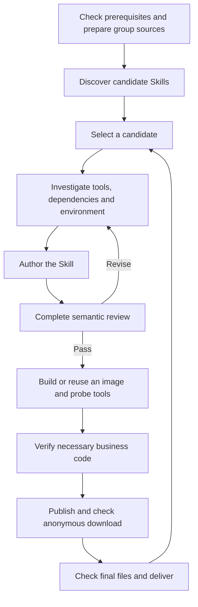

# Shared tool environment workflow

Each resource group is discovered once, then its candidates are built individually. Groups run serially and share source snapshots and a tool environment library.

Repairs return to the responsible stage: content to authoring, dependencies to environment preparation, and fixtures or assertions to execution preparation. A blocked candidate retains its reason and resumption conditions while other candidates continue.

## Stage responsibilities

| Stage | Work |
| --- | --- |
| Discovery | Read group sources, propose grounded tool capabilities with clear boundaries, and identify tools and gaps |
| Environment preparation | Inspect code, dependencies and official documentation; resolve versions, resources and invocation requirements; select reuse, extension or a new environment and prepare complete build materials |
| Authoring | Write instructions, representative code and useful supporting files; follow the runtime section template |
| Semantic review | Check sources, interfaces, logic, inputs, outputs and redundant text; decide which code needs execution |
| Environment build | Materialize build files, pin the base image and build, or pull a reusable image; probe actual versions and basic usability |
| Code verification | Supply minimal inputs and source-backed expectations; execute original code, with independent audit for complex wrappers and deferrals |
| Publication and delivery | Upload, verify content and anonymous access, replace the image placeholder, generate runtime.json, check final files, archive and export |

Environment preparation precedes authoring. Actual image construction follows semantic approval. Dockerfile content can be prepared early; image availability requires a successful build and tool probes.

## Docker and tool sharing

Images install tools and dependencies. Business code stays in Skill prose or scripts and executes inside that environment. The runtime section provides a pull command and a noninteractive execution example. The same code can run in a compatible local environment.

The program follows tools/catalog.json entries to each version's environment.json and matches installed tools, versions, platform and bundled resources. External weights or datasets do not distinguish otherwise compatible images. Each Skill selects its own required tools and resources for runtime.json. An extension preserves installed tools and bundled assets; it creates a new version while delivered Skills retain their existing tags. The Agent proposes a short environment name such as rdkit; the program allocates v1, v2 and later versions.

Images reside in Docker and GHCR. tools stores version metadata and complete build contexts. Local counters, preparation caches, locks and host command receipts stay in .pipeline/tool-libraries/. Preparation, successful local build, upload and anonymous access are recorded separately. Delivery requires independent anonymous requests and a credential-isolated pull to pass.

## Code verification decisions

The program inventories fenced code and scripts; semantic review decides how to handle each unit:

- Ordinary documented API usage and illustrative fragments can be exempt, with reasons recorded outside the package.
- Custom algorithms, complex parsing or conversion, and multi-tool glue require original-code execution and result checks.
- Necessary checks blocked by inputs, authorization or cost may retain concrete deferral conditions. Known code defects require repair.

An exit code or an output file alone does not establish a business result. Checks need source-backed content expectations or assertions. Fragments do not have to become standalone scripts.

Execution preparation can request source-backed assets through the existing acquisition component.
Cases select registered input files or archive members; the host mounts them read-only and binds
cached results to their content hashes. Weights stay outside the Skill package. Unavailable necessary
inputs remain concrete deferrals. A passed parser check does not establish full model inference or training.

Established factual errors require correction or removal before semantic acceptance, even when
the example runs. Optional presentation improvements remain nonblocking; source-backed rebuttals
must be reconsidered.

## Delivery requirements

verified packages pass semantic, environment and publication checks plus all necessary execution items. Explicitly exempt packages can also qualify. pending-validation contains packages with necessary code awaiting external validation after all other gates pass.

Build failures, inaccessible images and known content errors remain internal. Delivered packages contain no build logs, review findings or process evidence.

See [first run](../../README.md), [outputs](outputs.md) and [operations](batch-operations.md).
