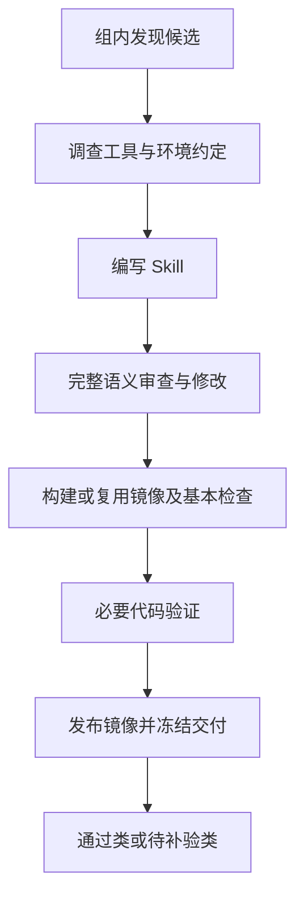

# 共享工具环境构建流程

新构建默认使用 `workflow: shared-environments`。它按资源组串行发现候选、调查环境、编写并进行完整语义审查，随后构建或复用工具镜像、检查环境、选择性执行必要代码，最后发布镜像和导出 Skill。

## 输入与启动

```json
{
  "workflow": "shared-environments",
  "resource_groups": [
    {
      "id": "method-a",
      "sources": [
        {"id": "code", "path": "./source"},
        {"id": "docs", "url": "https://example.org/docs", "related_to": ["code"]}
      ]
    }
  ],
  "research_access": "supplement",
  "environments": {
    "root": "./tools/environments",
    "image_prefix": "ghcr.io/your-account/your-project",
    "source_url": "https://github.com/your-account/your-project",
    "operation_timeout": 600
  }
}
```

`root` 和资源路径相对配置文件；镜像命名空间和源码地址必须改为有发布权限的项目。宿主需要 Python 3.11+、已认证的 Codex CLI、Docker Linux 引擎及镜像仓库登录。发布镜像还需允许匿名读取；程序使用无凭据的 manifest 检查确认可获取性。程序不自动修改镜像仓库公开性、不自动管理账号权限。

旧顶层 `sources` 自动视为单组，不能与 resource_groups 同时使用。各组 source ID 可重复；组 ID 必须不同。`related_to` 只指向本组原始输入。

```bash
python -m creation_pipeline build input.json --preflight
python -m creation_pipeline discover input.json --state-dir .pipeline
python -m creation_pipeline resume BUILD_ID --state-dir .pipeline
python -m creation_pipeline build input.json --state-dir .pipeline --library-dir skills
```

`--preflight` 只校验配置；真正 build/discover 启动时另做最小模型连接检查。discover 保存组内候选，resume 接续构建；新流程不使用旧 `--plan` 文件或 revise 命令。未配置限制时不默认设固定修复次数；显式开发预算仍生效。operation_timeout 是单次 Docker 命令的可配置时限，超时返回诊断和修复阶段，不直接证明候选代码错误。

新角色依赖原生文件与检索工具，当前新流程使用 codex_cli。deepseek_api 单次调用和旧运行协议仍通过 legacy-script-images 使用，不会静默切换后端。

## 阶段与角色



环境 Agent 负责版本、依赖、资源调查和构建修复。编写 Agent 负责包及依据。语义 reviewer 独立检查来源、接口、输入输出、逻辑及冗余，并给出包外必要执行清单。执行角色准备最小输入和断言；独立测试审阅确认它确实运行原代码、预期有据且没有替换业务逻辑，再由程序执行。

普通官方 API 调用、输入替换及说明性片段可免执行。自定义算法、非简单解析转换、索引合并及多工具衔接等需要执行。免执行不等于待补验。正文代码和脚本采用相同标准；不要求所有正文片段可独立运行，不要求把它们移入 scripts。

## 镜像与构建材料

工具环境库保存 catalog、环境描述和完整构建上下文。镜像只装工具和依赖，不复制当前 Skill 的任务脚本或测试。环境身份由构建材料、固定基础镜像和平台构成。符合所有版本和资源要求的环境直接复用；兼容扩展生成新版本；旧 Skill 保持原摘要。

环境计划的每个工具有 argv probe，必须实际导入或启动工具并输出一个 JSON 对象，例如 `{"version":"3.11.9"}`；程序比较实际版本。镜像内资源须检查可读性后在该对象的 resources 中返回对应名称的 true。环境 Agent 不能把一次成功退出当作版本一致证据。

发布至 image_prefix 下并关联 source_url；用户从项目 Packages 查找，通过 docker pull 下载。最终正文及 runtime.json 使用实际仓库摘要。本机 image ID 不作为用户下载地址。

## 交付与记录

```text
skills/
  verified/<name>/
    SKILL.md
    runtime.json
    scripts/                 # 按需
  pending-validation/<name>/
  catalog.json
tools/environments/<id>/<version>/
  environment.json
  context/Dockerfile
  context/...                # 完整构建输入
.pipeline/
  cache/snapshots/
  runs/<batch>/groups/<group>/candidates/<name>/
  records/<batch>/
```

通过类要求语义、环境、发布和全部必要执行项通过，也包括无需执行项的 Skill。必要验证受外部条件或成本限制但环境合格时进入 pending-validation。已知未修复错误、环境或发布失败保留在内部。新流程保留可恢复工作区，不自动到期删除其共享依赖。

runtime.json 是程序生成的使用要求：固定镜像、平台、工具版本、外部资源及特殊条件。它不包含 build、构建日志或审查依据。正文只给一次镜像使用示例；后续代码保持普通工具写法。先使用 `{{image}}` 草稿引用，发布后由程序替换，补全后核对文件与审查对应关系。

```bash
python -m creation_pipeline library skills
python -m creation_pipeline library skills --include-candidates
python -m creation_pipeline install skills --name SKILL_NAME --destination ./installed
python -m creation_pipeline install skills --name SKILL_NAME --include-pending --destination ./installed
```

安装只复制纯包，不附带 .runtime。catalog 保留包指纹，包被修改时不会继承通过。名字冲突不覆盖；失败写入可根据已复制且校验一致的目录恢复。

人工补验使用显式报告：image 为该包固定镜像，package_sha256 为 catalog.files 的 fingerprint，每个未完成项列出 item_id、status=passed 和 evidence。执行 `promote LIBRARY NAME --report REPORT.json` 后迁入 verified；它是人工提供证据的晋级，不会自动再运行工具。旧待补验副本保留至显式清理，catalog 为有效位置。

## 受阻与恢复

保存失败日志和尝试历史，由当前职责 Agent 判断重试或反馈其他阶段。临时故障允许原操作再试，其他修复需说明新依据或变化。确实无法继续时返回原因、已试方法和恢复条件，程序暂存该候选并处理其他候选或资源组。resume 不重新发现已经保存的候选。

正文措辞修改只复审相关内容；业务代码变化重验受影响项；依赖变更重查环境及相关代码。新本地目录锁由操作系统管理，进程退出后可再次获得锁。构建及发布结果仍需核对，锁释放不等于半成品成功。

## 工作区保留与清理

```bash
python -m creation_pipeline pin BUILD_ID --state-dir .pipeline
python -m creation_pipeline unpin BUILD_ID --state-dir .pipeline
python -m creation_pipeline prune --state-dir .pipeline --older-than-days 7 --dry-run
python -m creation_pipeline clean BUILD_ID --state-dir .pipeline --dry-run
```

移除 dry-run 后才执行清理。只清理已完整归档且全部候选通过的工作区；活跃锁、保留标记、待补验或受阻候选会阻止清理。资料快照、工具环境及长期记录不在该清理范围。归档包损坏或缺失时拒绝删除工作区。人工晋级不会自动删除旧工作区。

## 仅在本机测试

输入设置 `environments.publish=false` 可以验证本地构建和必要代码，不向远程仓库发布。
结果使用 `local-verified` / `local-pending-validation`，批次完成状态为 `local_validated`。
它们不会进入正式 Skill 库；本地镜像引用在候选 record 的 local_image 中。草稿仍可能含
`{{image}}`，不能把它当作已经发布的交付包。默认 publish=true 的发布门槛保持不变。

## 历史协议

旧脚本镜像流程必须显式设置 `workflow: legacy-script-images`。旧 runtime-* 命令及 manage、冻结证据和具体入口协议用于历史成果，不将旧通过状态转换成新环境资格。历史示例已标注该 workflow；新例子见 examples/shared-environments。新库不能覆盖旧格式 catalog，应选择新库目录或另行迁移。

当前真实 Docker 构建、发布和模型质量验收需要可用引擎、账号与源资料；离线模拟测试不代表这些外部环节已通过。


## RDKit 实测后的第二轮调整（代码已调整，尚未测试）

主顺序保持：启动预检 → 每组发现 → 每个候选环境准备 → 编写 → 完整语义审查 →
Docker 构建/复用及基本探测 → 必要代码验证 → 发布与交付。资源组仍然串行，不增加新 Agent。

- 启动检查统一到 shared/preflight.py：CLI 新会话/恢复参数、Docker Linux 服务端、发布配置；
  构建入口再通过模型实际做工作区写入、共享缓存 helper 写入和恢复会话操作。恢复时重新观察
  CLI/引擎，近期成功的实际权限检查可复用一小时；配置、程序或引擎身份改变会失效，模型调用失败
  也会清除本批成功记录。discover-only 不要求 Docker。发布关闭时不要求镜像仓库配置。
  readiness 不调用模型，因此其 ready 不代表模型权限检查已执行。
- 环境准备使用内部 contract_version=2：conditions 为明确的加速器、最低内存（未知为 null）
  和任务执行联网条件；usage_notes 只放确实影响使用者的必要条件。调查经过、构建/探测备注和
  待查项分别进入 investigation_notes/unresolved。runtime.json 由 contracts.py 白名单生成，
  不含内部版本号、证据、探测命令、Dockerfile 或构建历史。自由文字不参与环境兼容匹配。
- tools/environments/prepared-plans.json 保存“调查已完成、镜像尚未验证”的资料。只有明确版本、
  没有待查项/运行资源、完全相同的来源及本组定位映射、且方案无歧义时才自动复用；其余情况
  把相关调查作为环境 Agent 的参考，只补查差异。跨组 eN 不直接混用；共享资料仍需本组登记。
  此缓存不授予镜像可用资格，Docker 探测仍然必须完成。
- 审查 findings 带 owner：content 修正文/脚本，environment 修复程序投影的环境资料。
  单位、数据含义、错误前提和影响使用的内部备注是实质问题；纯排版偏好不阻断。
  静态检查验证 runtime 投影、runtime 链接、镜像拉取及非交互执行入口，语义审查仍负责命令
  正确性和科学含义。没有加入章节、字数或完整示例输入的统一配额。
- 错误按类型路由：审查范围错误回审查，夹具路径错误回验证准备，文件权限/记录/完整性错误
  停在本候选当前阶段。Docker 启动失败不当作业务代码错误；构建失败不能要求作者改 Skill。
  只有执行结果需要诊断归属时才调用修复角色；要求改正文必须给原代码位置和来源证据。
- 验证方案根据风险决定独立审查：上下文注入、函数替换、复杂包装、不确定预期、可执行夹具
  及延期项需要审查。普通直接调用配数据文件可省去该模型轮次；原代码引用、覆盖和执行结果的
  程序检查始终存在。必须验证但缺外部条件的代码仍可进入 pending-validation。
- 归档/导出错误单独保存 archive_error/adoption_error，保留原验证状态并继续下一候选；恢复时
  重试交付。归档标识不再包含自身记录路径；JSON 原子写入使用独立临时文件。
- 新流程作者不继承发现会话；阶段上下文只传近期错误、历史记录路径和当前要求，编写/审查
  不接收完整 Docker 构建材料。全文历史仍留在内部记录中。

旧合同和本轮新合同不自动互认资格。之前的 RDKit 三份原始样品及其历史测试记录保持原样，
本轮需新开批次验证，不能用历史通过数代表新版本已经通过。
