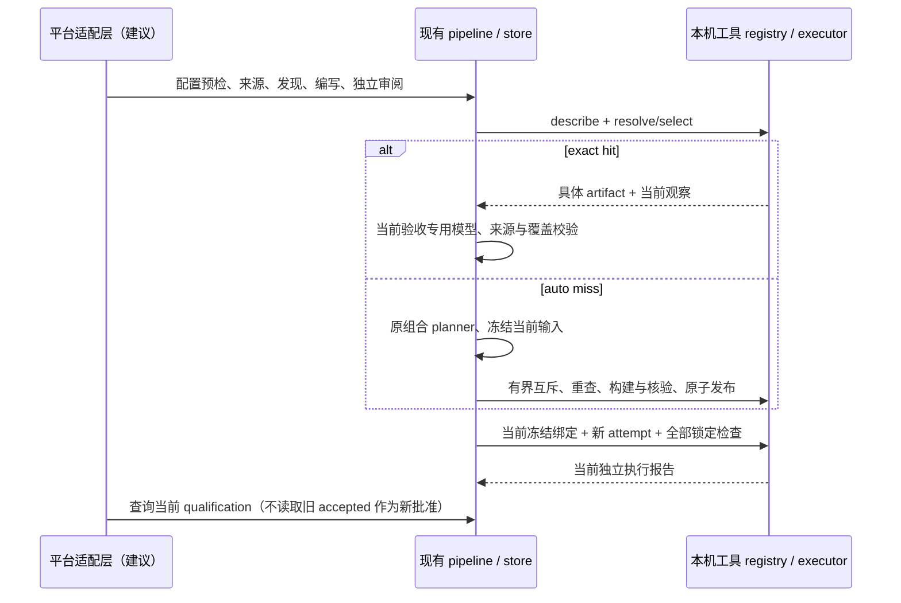

# Skillnet 本地接入契约与适配建议

核对基线 `6e54875`（P0 与 P1-1）。本文是本地实现的接口清单和未来适配说明，**没有新增
HTTP 服务、远端 executor、平台数据库或 OCI 分发**。下文“现有”指 Python/CLI/磁盘协议，
不是承诺稳定的公共 SDK；“建议”需未来单独实现。机器清单和可执行最小示例见
[skillnet-contract.json](../../validation/deepseek-api/skillnet-contract.json)，离线交叉验证入口为
`python validation/deepseek-api/verify_skillnet_contract.py`。不读取凭据或启动 Docker/模型。

P2 增量：现在另支持 `shared_tool_image_v3` / `closed-python-json-data-v1`，见
[JSON 资源协议](bundled-json-tool-protocol.md)。ToolArtifact 外层仍为 v1 字段集；新 declaration
增加 bundled_data[module,path,sha256]，ABI 与声明进入 request_key 和 artifact_id。
recipe_key 仍仅覆盖实际 plan/base_image，不因为升级 ABI 就必然改变，不能拿它代替请求身份。
SkillBinding 与 RuntimeRequest 没有新增字段，平台能力协商须明确支持此 ABI，不能降级或删字段。
下文原 v1/v2 清单作为此前核对基线，v3 的边界以增量协议为准；机器版本清单和离线校验已更新。
原生编写/审阅 handoff 增加 host 的 tool_execution_layout，区分当前 Skill 包和工具镜像文件集；
它不是新增的持久化 Binding 字段、业务事实或平台 API，不改变运行要求及模型预算。

此前 P1-2 轮的字段/版本/入口/错误锚点交叉验证、3 项针对性回归和三个提示自检通过，证据见
[skillnet-contract-results-20261101.json](../../validation/deepseek-api/skillnet-contract-results-20261101.json)。
验证包含真实离线 CLI 预检/空 registry 查询，以及虚构字段/不存在入口被识别的负例。
未重跑上一轮完整 731 项，也不将该历史结果计为本轮证明。自动检查不能验证全部文档语义，
更不证明未来平台端到端互通；字段落点、状态转换和迁移限制仍逐项按当前源码核对。

## 身份与版本

`contracts.fingerprint(x)` 是 UTF-8 JSON（sort_keys、ensure_ascii=false、紧凑分隔符）的
SHA256；必须复用程序的 canonicalization，不能散列 pretty JSON 或不同字段子集。
`versioned(payload)` 为 `{version:1,payload,sha256}`，sha256 只覆盖 payload。

| 对象（逻辑名称） | 当前字段与持久化落点 | 身份、版本与状态 |
| --- | --- | --- |
| Skill | `catalog.json` version 2 中条目：name/path/zone、candidate_id、revision_id、execution_location、evidence、freeze_sha256、delivery、history；可选 runtime/pending_runtime/runtime_history/diagnosis；动态 current_content/current_execution/current_host/current_qualification | candidate_id=`candidate-`+fingerprint({name})，仅本地名称维度，不是跨租户全局 ID。revision_id=`rev-`+fingerprint(delivery.inputs)。zone=accepted/candidates 不代替当前资格查询 |
| EnvironmentArtifact | `shared_environment` 的 `<recipe_key>.json`：recipe、daemon_id、image_id、complete_rebuild_lock。recipe={abi:1,base,platform,prefix_text,files}，files 含 path/sha256/mode；base 是固定 repo digest | recipe_key=fingerprint(recipe)；没有独立 artifact_id，也没有不可变版本表。重建可更新此本地观察指针；ToolArtifact 中嵌入的具体环境观察不会因此改写。inspect 状态与登记事实分开 |
| ToolArtifact | `<request_key>-<artifact_id>.json` 精确字段见机器清单；包含 request、去掉验收的 plan、base_image、environment、daemon_id/image_id；v2 另含 external_identity | request_key=fingerprint(request)，recipe_key=fingerprint({plan,base_image})，artifact_id=fingerprint(除 artifact_id 外整个记录)。本机 v1/v2 ABI 独立于 delivery protocol；记录不含 Skill passed/qualification |
| SkillBinding | **逻辑对象，非独立资源表**。`inputs.bindings.payload` 保存入口/来源关联：entry/source_id/source_path/association/entry_sha256/source_sha256 等；`inputs.environment.payload.shared_tool` 保存 abi/request/request_key，可选 artifact/selection；首建具体版本由 receipt.tool_artifact 与 request 指纹绑定 | 命中时冻结 artifact；首建在执行前先冻结请求，构建后回执绑定具体版本，不能回写 freeze。共同由 revision/freeze 与 RuntimeRequest 全组指纹证明，不存在单独 binding_id。版本封套是 inputs.bindings.version，不能当作 Tool ABI |
| ExecutionAttempt | 独立 runtime 目录：attempt-start.json、receipt.json、build-log.json、execution/{started,tests,report}.json 及有界输出；catalog runtime 引用含 path/files/status/execution_status/image_id/host/revision_id 等 | attempt 目录通常为 candidate_id/UUID，但无全局 attempt_id 字段或独立协议。RuntimeRequest 是 frozen dataclass，精确字段见机器清单；receipt version 2、当前 report version 1 / acceptance_version 2 是不同版本域 |

Tool request 精确包含 abi/declaration/files/entry/entry_sha256/requirements/constraints/runtime_limits。
files 为排序的 `{path,sha256,bytes,mode}`；declaration 包含 closure/requirements/interface/platform/policy。
request_key 在环境规划前可知；recipe_key 是具体配方；artifact_id 是观察到的具体制品，三者不可合并。
当前 `(daemon_id,image_id)` 是本机身份，**不是 OCI manifest digest**。EnvironmentArtifact 的
`complete_rebuild_lock=false` 不能证明依赖闭包可重现构建。v1 只支持有限 Python 闭包；v2 只支持
当前 Open Babel Debian 包装入口及可执行文件/动态链接/插件/数据/rootfs 身份协议，不能泛化为任意 executable。

Skill delivery protocol 2 的 inputs 为 candidate/files/sources/requirement/bindings/environment/
acceptance/layout，后四个为版本封套；bindings/environment/acceptance/layout 各自 version=1
并不表示同一个协议。fingerprints 覆盖 files/sources/bindings/environment/acceptance/layout。
layout 保留调用方原文、精确必需路径与引用；改布局、源字节、接口、要求、策略会产生 miss 或新修订。
RuntimeRequest 没有独立 layout_fingerprint；revision_id/freeze_sha256 已覆盖该要求，不应虚构现有字段。

## 现有调用顺序与边界

| 阶段 | 当前入口 | 效果与必须保留的边界 |
| --- | --- | --- |
| 配置预检 | `build CONFIG --preflight` | 仅配置合法性，source_availability=not_checked，0 模型；不是来源、镜像或资格确认 |
| 能力发现 | `discover CONFIG` / `plan CONFIG` → pipeline.build(plan_only=true) | 来源获取与发现模型，输出候选计划；不等于 ToolArtifact 精确匹配或合格 Skill 检索 |
| Skill 检索 | `library LIB [--name NAME] [--include-candidates]` → store.entries/get | 默认排除候选；当前条目会 reconcile/查询资格，不允许直接写 accepted。与语义能力发现不同 |
| 编写与审阅 | `build CONFIG` 或 `build --plan PLAN` | 交付原路径检查、独立内容审阅、来源/接口核验；平台不能以模型自述代替这些门禁 |
| 精确解析 | shared_tool.describe → resolve；显式版本走 select | 内部 Python 接缝，不存在独立 resolve CLI/HTTP。只读不建目录/锁/镜像；resolve 可自动 miss，显式 select 失败阻止，不换版本 |
| 准备与具体绑定 | preparation.prepare / `runtime-prepare LIB --candidate NAME --spec SPEC` | 同一要求命中后省环境 planner 与两类 build；验收专用模型仍为当前 Skill 编制计划。miss 走组合环境/验收规划。严格原预算、来源引用、覆盖和 native check 校验 |
| 冻结/构建 | evidence.seal → contracts.runtime_request → LocalExecutor.build | 冻结当前 Skill 和合同；锁内重查；完整身份/内容核验后才原子发布。built 不等于业务通过 |
| 当前可用性 | runtime-tools-inspect / runtime-shared-inspect；LocalExecutor.verify_current | 在线检查当前 daemon/image。工具 inspect 的 available 只做元数据（v2 另做外部闭包观察），不等于执行前对两份工具树与当前包的完整字节核验 |
| 独立执行 | execute_prepared / `runtime-validate LIB --candidate NAME` | 新 attempt 执行当前冻结合同；不是重新编制验收。要改变合同须来源诊断/独立审阅后的新修订，不能复制旧 passed |
| 当前资格 | `runtime-inspect LIB --candidate NAME` / store.get / contracts.qualify | qualify 需要实际 runtime_root/ref、freeze 与当前 executor 上下文。返回 accepted/reason；runtime-inspect 另有 content/historical_execution/pending/action。读 frozen delivery.qualification 不是当前资格 |
| 恢复与安装 | runtime-import、runtime-relocate、runtime-resume、install | 导入/迁移先撤销资格；新 attempt 重新执行。具体共享镜像缺失时不以新构建替换原版本 |



requirement=not_required 是独立审阅且有来源支持的合法无执行分支；unknown 必须阻止。
当前建库采用 adopt，后续查询会检查地点、冻结字节、当前证据；accepted 不是永不过期的永久事实。

## 状态及错误的实际形态

delivery.content 为 not_reviewed/passed/failed；delivery.execution 的声明枚举是
not_run/runtime_blocked/build_failed/execution_failed/passed。构建 receipt 使用 built，
执行 report 使用 execution_passed，catalog current_execution 又可能用 passed；平台需映射，
不能把这些同名字段当一个统一状态机。资格始终单独为 `{accepted:boolean,reason:string}`。
离线工具观察为 historical_unverified，在线有 available/different_daemon/image_unavailable_or_changed/
environment_inheritance_changed/invalid_record；环境观察还可能 pending_or_interrupted/host_unavailable。
ABI/策略失效通过记录验证拒绝，不能信任历史命中。

| 原始对象/错误 | 当前载体 | 平台处理建议（尚未实现） |
| --- | --- | --- |
| selected_artifact_not_found / invalid_selected_record / selected_request_mismatch | select 的 blocked observation，附 reference/path 或 mismatches[field,expected,actual] | 要求选择有效版本或明确新修订；不自动换版本 |
| no_available_exact_request | resolve miss，附 candidates/other_versions | 允许原授权规划；不是所有错误都可重试 |
| different_daemon / image_unavailable_or_changed | 当前观察 reason | 当前不可用；原版本恢复或新修订，不能改 image_id 冒充命中 |
| required_delivery_file_missing / unexpected_delivery_file | layout findings，含 path/expected/actual/sources | 内容修复；不是加预算或改环境 |
| delivery_layout_mismatch / resources_unknown / requirements_unknown / plan_unresolved | preparation.gaps 或 executor preflight.gaps，含 code/detail/repair_lane/blocker_kind；resources_unknown 来自 LocalExecutor | 按 content/environment/requirement 等 lane 分流；不得改弱合同 |
| caller_cancelled / shared_tool_unavailable | build receipt.gaps；取消仍抛 KeyboardInterrupt | 保存中断与 scope/cleanup；不授予资格 |
| shared_tool.lock / shared_tool.policy / shared_tool.current_acceptance_required | ValueError 文本前缀 | 保留原 detail；不能当成稳定独立 JSON code 枚举 |

CLI 正常 JSON 输出到 stdout；状态错误常用 exit 1；配置/文件 ValueError、OSError、KeyError
通常为 stderr `{status:"error",error:"..."}` 和 exit 2。exit 0 **不是 accepted=true**，例如
inspect 或历史观察。取消可传播异常而没有普通响应。建议统一 transport error 封套，但必须保留
raw reason、字段/路径、期望/实际、来源引用；当前并没有统一 HTTP status、retryable 或 trace_id。
catalog 查询路径会调用 recover/reconcile，可能恢复未完成的本地事务，不能承诺完全没有文件系统
副作用；registry 的 resolve/inspect 才是本文明确的只读接口。平台需分别定义查询权限和审计。

## 最小请求/响应

以下现有 CLI 示例为结构示例；路径由运营者配置，不可让租户提交任意主机路径：

```text
python -m creation_pipeline build CONFIG.json --preflight
=> {"status":"configuration_valid","source_count":1,"source_availability":"not_checked","model_calls":0}
python -m creation_pipeline runtime-tools-inspect --root EMPTY_LOCAL_ROOT --offline
=> {"abi":"shared_tool_image_v1","supported_abis":["shared_tool_image_v1","shared_tool_image_v2","shared_tool_image_v3"],"registry":"EMPTY_LOCAL_ROOT","artifacts":[],"pending":[],"business_acceptance":"not_run"}
python -m creation_pipeline runtime-inspect LIB --candidate NAME
=> 字段包含 name/revision_id/zone/content/qualification/pending/action（见实际源码，不承诺固定可选字段集）
```

显式选择的现有 runtime spec 片段：
`{"tool_artifact":{"request_key":"<64hex>","artifact_id":"<64hex>"},"shared_tool":<独立且完整的声明>}`。
这是片段，不能单独当完整配置；引用不包含路径，声明不可由引用替代，也不包含 acceptance_plan。
当前 CLI 不直接接受请求键查找任意兼容工具，必须先建立可核验的当前请求。

机器清单另给出建议 `skillnet-local-adapter/v1` 的 resolve/qualification 请求响应示例，
清楚标记 implementation=proposed，不发送到任何 endpoint。建议 envelope 字段为 api_version、
operation、request_id、data/error；error 含 code/object/field/expected/actual/source_refs/raw。
这些字段不应伪装成当前 pipeline 的原生输出，示例中的身份仅为占位，不代表已登记制品。

## 最小平台适配工作与迁移

1. **命名与权限（建议）**：平台分配 tenant/Skill/attempt 全局 ID，与本机 name/candidate/revision
   建映射；主机路径、daemon target、资源引用使用服务端 allowlist。现有协议未实现多租户鉴权。
2. **入口封装（建议）**：先包装当前 CLI/同版本 Python façade；发现、只读解析、准备、执行和
   资格查询分别授权。预算/后端从已授权配置传递，不因 miss/错误自动增加或切换。
3. **DTO 与证据（建议）**：五类逻辑对象投影到平台 DTO；保留原 schema/version、hash、证据引用和
   原始状态，新增绑定/attempt 全局 ID 仅作为别名。不可直接写 catalog accepted 或伪造回执。
4. **当前观察（建议）**：查询带 observed_at/target_id、明确新鲜度策略；静态 revision 可缓存，
   available/qualification 必须按当前目标重验。现有观察并非统一 TTL API。
5. **调度与幂等（建议）**：平台 request_id/幂等键/任务取消需另实现；request_key 只是工具兼容身份，
   不可拿来缓存执行结果。沿用当前互斥 deadline、所有者 token、原子发布；不自动抢崩溃锁。

旧 delivery protocol 1 可读，缺少调用方 layout 不等于路径合格；先 `check --config ORIGINAL`，
或依原要求生成 protocol 2 新修订。不能通过重算 hash 给历史记录补资格。EnvironmentArtifact
继续保持旧本机观察格式，不迁成虚构 artifact_id；Tool v1/v2 按原 ABI/policy 校验，无自动升级。
安装使用普通包和旁置 `.runtime/<name>/{frozen,attempt}`；原生 output 或完整 envelope 可导入。
裸包、缺回执、archive/OCI 交付不支持。搬迁撤销旧地点资格后重验，镜像丢失不得静默重建替换。
本机 Docker save/load 的故障恢复实验不是平台远端分发 API。

未来若确需远端，应先单独设计身份类型、分发与拉取验证、目标信任和证据回传；本轮既不实现，
也不把 local-docker target 或 Docker image ID 改名为远端/OCI 身份。
