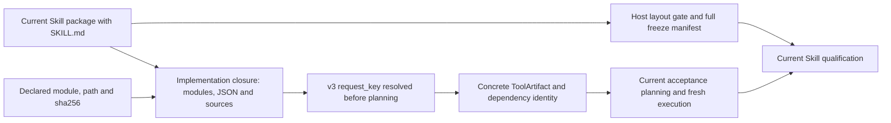

# File-relative JSON resources: shared_tool_image_v3

This protocol supports fixed UTF-8 JSON reads anchored to a module's __file__. runtime/bundled_data.py checks source closure, resource locations and original bytes; execution rechecks the frozen binding.

policy=closed-python-json-data-v1 selects ABI=shared_tool_image_v3. The declaration contains closure, requirements, interface, platform and policy, plus a nonempty bundled_data list:

```json
{
  "module": "scripts/triage.py",
  "path": "scripts/data/rules.json",
  "sha256": "<64 lowercase hexadecimal digits for the original file bytes>"
}
```

This is one list item, not a complete declaration. module and path are exact, case-sensitive, safe package-relative paths without links. module must be .py and path must be .json. Files must exist, match the declared raw SHA256 and parse as UTF-8 JSON. Duplicate pairs, missing files and unused declarations are rejected.

Supported access:

```python
from pathlib import Path
payload = (Path(__file__).resolve().parent / "data" / "rules.json").read_text(encoding="utf-8")
```

A single literal "data/rules.json" is also accepted. Path aliases or rebinding, variable paths, intermediate Path variables, parents indexing, .., absolute paths, read_bytes, other encodings, writes, other __file__ uses, reflective bindings and dynamic loading are unsupported. Path names may occur only in recognized fixed-read expressions. References to excluded SKILL.md and prohibited execution/loading constructs remain rejected. Unrecognized structures receive a named rejection rather than inferred compatibility. This is a bounded source-shape protocol, not a complete static analysis or safety proof for Python.

Fixed resources belong to the tool implementation closure, not resource_refs or external mounts. Modules, supporting code, data and complete sources enter the request with path/sha256/bytes/mode. Declarations and expected hashes also enter the request. The interface requires /opt/skill, resources=[], runtime_network=false, Linux/amd64, explicit import versions and executables=[]. Arbitrary subprocesses, dynamic imports and external file resources are unsupported.

Authoring and independent review receive tool_execution_layout. The host checks the complete Skill package against its frozen layout; the tool image's package excludes the current SKILL.md. Layout information supplies no business oracle or execution evidence. Native checks retain implementation hashes, rule values and business obligations while checking the appropriate file tree. Configuration need not manually supply protocol-source material. Exception bindings, pattern matching and attribute assignments that rebind Path or __file__ are rejected.



Both initial builds and hits verify the current frozen package, sources, entry mapping, both image tool trees and actual dependencies. A read-only non-root container executes the current locked contract. Resource hashes do not prove JSON business meaning, output correctness or Skill qualification. Hits still require independent review, current acceptance planning and a new ExecutionAttempt.

Changing modules, data, dependencies or interfaces changes the request. Changing data without its declared hash first reports `shared_tool.bundled_data.<path>: expected sha256=...; actual=...`. Updating the hash creates a new request. Explicit selection of a mismatched version returns selected_request_mismatch without substituting another version. Undeclared reads identify the module, expected path and actual target; missing files report their path and missing_or_linked.

ToolArtifact retains the v1 outer fields, without v2 external_identity. recipe_key and artifact_id algorithms are unchanged; ABI and declarations participate in identity. SkillBinding, RuntimeRequest and delivery protocol 2 fields are unchanged. v1/v2 records use their own validators. Clients that do not support v3 must reject it rather than strip declarations or downgrade qualification. This protocol provides no remote registry distribution, automatic dependency merging, result cache or platform database migration.
