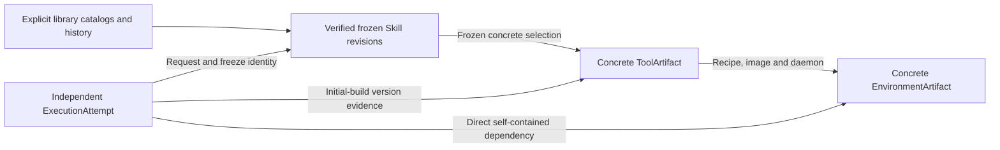

# Read-only reverse references v1

CLI: python -m creation_pipeline manage REQUEST.json, operation references.query. The envelope is chem-local-management/v1 and data protocol is chem-references/v1. creation_pipeline/references.py exposes query(params) → (data, evidence); management.dispatch returns the complete envelope.

Queries identify Skill revisions/frozen bindings that depend on concrete tools, tool versions associated with concrete environments, and related attempts. Results describe recorded dependencies rather than availability, qualification or deletion permission.



## Explicit scope and identities

```json
{
  "api_version": "chem-local-management/v1",
  "request_id": "refs-001",
  "operation": "references.query",
  "params": {
    "libraries": ["E:/operator/library-a", "E:/operator/library-b"],
    "tool_registries": ["E:/operator/shared-tools"],
    "environment_registries": ["E:/operator/shared-environments"],
    "target": {
      "kind": "tool",
      "request_key": "<64 lowercase hex digits>",
      "artifact_id": "<64 lowercase hex digits>"
    }
  }
}
```

Replace placeholders. All three root arrays are required. An empty array means that category was not scanned. Roots must be absolute and unlinked, without duplicates within an array. The query does not use default registries from .env or environment variables or search sibling checkouts. Missing roots produce diagnostics without creating directories.

An environment target uses:

```json
{
  "kind": "environment",
  "recipe_key": "<64 lowercase hex digits>",
  "image_id": "sha256:<64 lowercase hex digits>",
  "daemon_id": "<observed local daemon identity>"
}
```

A tool requires request_key + artifact_id, not only a request key or image tag. An environment requires dependency recipe_key + image_id + daemon_id. Rebuilt images or different daemons remain distinct. Local image IDs are not OCI manifest digests, and tool recipe keys cannot substitute for dependency-environment recipe keys.

## Scanning and deterministic joins

| Input | Read scope and association |
| --- | --- |
| Library | Current/history v2 catalog revisions, all evidence/<candidate>/<version> snapshots and runtime/<candidate>/<attempt> directories, including uncataloged entries and missing catalog targets |
| Frozen snapshot | Freeze manifest, record, revision fingerprint, versioned content hashes and static shared_tool bindings; source files are checked without execution |
| ToolArtifact | Published registry JSON and concrete records embedded in freezes/receipts, using shared_tool.validate_record to check filenames, requests, recipes and artifact_id |
| EnvironmentArtifact | Published native recipe v1 records, checking content, filename and concrete image/daemon, joined to the corresponding embedded environment tuple |
| ExecutionAttempt | Complete receipt request, freeze/build-log hashes, report request/image/tag and cataloged attempt manifests, without filtering on passed/accepted |

Catalog traversal permits only these relative evidence/runtime layouts. Absolute paths, .., links and unknown layouts produce diagnostics; registry, source and previous-host paths in records are not followed outside the declared roots. Active accepted/candidates packages, installed envelopes, native outputs and preparations/diagnostic directories do not discover bindings implicitly. Qualification remains responsible for active-package drift and business results.

An initial-build frozen shared_tool can contain a request without a concrete artifact. A complete build receipt for the same freeze must then establish the version with consistent request, recipe, image and selection identity. A frozen concrete selection creates a dependency even before execution or after failure. A self-contained receipt's shared_environment can create a direct environment edge without inventing a ToolArtifact.

delivery/freeze/tool ABI values identify protocols. inputs.bindings/environment/acceptance version values are positive content-revision counters from preparation.rebind; they are not restricted to 1. Unknown protocol versions are rejected or diagnosed by their validators rather than assumed compatible.

## Results and uncertainty

Successful data always contains the fields below. Top-level evidence uses path/kind/sha256 from bytes actually read; missing or rejected reads have null hashes. Raw source content is not copied into responses.

| Field | Meaning |
| --- | --- |
| protocol, observed_at, target | Query protocol, UTC time and full target identity |
| scope.requested / roots | Exact requested arrays and per-root traversal status; one failing root does not discard others |
| scope.unscanned_categories | Categories omitted through explicit empty arrays |
| scope.complete_within_declared_layouts | No corruption, pending publication, locks/transactions or unresolved bindings within the supported declared layouts |
| scope.global_complete | Always false; other roots were not scanned |
| scope.layouts / not_scanned | Supported layouts and explicitly excluded inputs |
| target_registration | found_in_scope / not_found_in_scanned_roots / not_scanned, with verified and attempted paths |
| matches.tools | Matching concrete ToolArtifacts, recipe/image/daemon, environment_reference, registry paths, observation sources and evidence |
| matches.bindings | Verified library/name/candidate_id/revision_id/freeze_sha256/freeze_path, tool/environment_reference, catalog_roles, attempt_paths and evidence |
| matches.attempts | Associated paths and request identities, with recorded build/report state and a distinction between concrete observations and frozen requirements |
| unresolved_bindings | Requests without concrete versions and corrupt/missing freezes claimed by catalogs; unverified catalog claims carry catalog_claim_only=true |
| issues | Original code/path/field/expected/actual/reason/evidence, retained even when other records are valid |
| index | Counts of all observed tools/environments/bindings/attempts; storage=ephemeral_rebuilt_each_query |
| interpretation, availability, qualification | Interpretation boundaries; availability and qualification are always null |

binding_id is a query-derived join identity based on library, freeze and tool/environment identities, not a persistent SkillBinding or replacement for its fingerprint. Copies in different libraries retain separate paths. Empty catalog_roles marks a scanned freeze absent from the catalog rather than a current Skill. Index counts cover all observations; matches projects the target. Unresolved records and diagnostics conservatively cover the complete declared scope because damaged records may not reveal whether they affect the target.

Invalid shapes, identities or out-of-scope roots return request_invalid/exit 2 before scanning. Record problems can produce successful partial observations with ok=true/exit 0: callers must inspect scope/issues. Diagnostic codes include record_missing, record_invalid, linked_path, unsupported_layout, catalog_reference_mismatch, catalog_pending, publication_pending, scan_changed, tool_record_not_found_in_scope and environment_record_not_found_in_scope.

A damaged registry does not erase a verified embedded reference, but missing registration is explicit. A damaged freeze cannot create a confirmed binding; its catalog claim and errors remain. Every query rereads data and rebuilds the derived index without persistent scan caches or inherited trust.

## Read-only behavior and impact

Queries do not call store.get/reconcile/recover/locked, qualify, executors or models. They do not acquire/update/delete locks, alter qualification or records, manipulate containers/images or register artifacts. Only side_effects.filesystem_reads is true. Locks, transactions and .json.tmp files are diagnosed without reading temporary artifact content, stealing locks or waiting for builds.

Directory membership, record hashes and verified frozen trees are rechecked after reading. Changes produce scan_changed without retries or locks. This is not a cross-root/process atomic snapshot and cannot rule out adversarial filesystem races; it is intended for a trusted local operator.

References indicate potential dependency impact, not current availability or qualification. Losing an environment record or its standalone image does not prove a derived tool image cannot run. Use the corresponding availability and qualification interfaces. This API provides no deletion, GC, safe-deletion decision, remote directory, HTTP or multitenant service.
