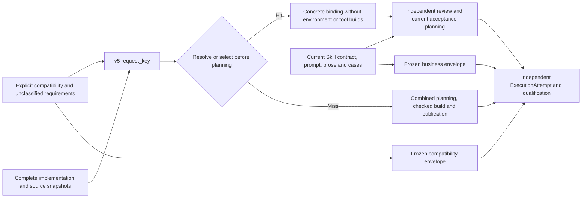

# Tool compatibility and Skill business contracts

shared_tool_image_v5 / request_protocol=2 freezes tool_compatibility separately from skill_contract. Implementation: runtime/request_contracts.py.

## Caller fields

Supply shared_tool, tool_compatibility and skill_contract together in runtime_defaults or candidate runtime settings:

```json
{
  "tool_compatibility": {
    "version": 1,
    "source_policy": "complete-snapshots-v1",
    "requirements": {
      "base_image": "python:3.11-slim-bookworm",
      "language": "python",
      "language_version": "3.11"
    },
    "constraints": {
      "dependency_files": ["package/requirements.txt"],
      "install_commands": ["python -m pip install --no-cache-dir -r package/requirements.txt"],
      "environment": [
        {"name": "PYTHONDONTWRITEBYTECODE", "value": "1"},
        {"name": "PYTHONUNBUFFERED", "value": "1"}
      ]
    }
  },
  "skill_contract": {
    "version": 1,
    "requirements": ["Preserve the source's business outputs and normal/invalid-input obligations."],
    "constraints": ["Follow the current operator guidance and independently prepare and execute acceptance checks."]
  }
}
```

This is a scoped excerpt; supply these fields alongside a complete shared_tool declaration. Without an explicit plan/acceptance_plan, discovery, authoring, independent review and current acceptance planning still run.

The caller selects explicit scopes; the model does not infer them from arbitrary text. Unknown fields, versions or source policies are rejected. Real tool requirements must remain in compatibility fields or unclassified requirements. Business capability still needs sources, independent review and execution evidence.

| Meaning | Location | Identity and checks |
| --- | --- | --- |
| Imports/executables, argv, WORKDIR, platform, network, resources, closure policy | shared_tool declaration | All remain in the request with their existing support boundaries |
| Base/language/version, dependency files, install commands, planned ENV | tool_compatibility v1 | Enter the request and compare to the actual plan field by field; build/binding also checks installed Python/dependencies and complete images; 3.11 denotes a version prefix |
| memory/cpus/pids | options → request.runtime_limits | Exact identity inputs; preparation deadlines and model selection are separate |
| Runtime requirements/constraints | tool_compatibility.unclassified | Complete strings remain conservatively in the request and anchoring/planning |
| Unclassified top-level config.constraints | unclassified.caller_constraints | Full object and values participate, preserving unknown runtime constraints |
| Explicit current business requirements/constraints | skill_contract v1 | Separately frozen; constrain current planning and invalid-input anchoring without entering the tool request |
| Current prompt, notes, constraints and configured cases | skill_contract.caller_context | Deterministic caller snapshot; prompt guides the current Skill, while native case mappings remain locked and executed |

Free-text business meaning cannot be completely classified statically. Unknown compatibility requirements must not be relabeled as business text to improve hit rates. Retain conservative unclassified requirements or use the applicable protocol. Changes to unclassified strings/values cause a named miss; unsupported structures are rejected. A complete compatibility declaration does not qualify a new Skill. An unsatisfied current contract blocks that Skill without altering existing artifacts or bindings.

## Conservative source closure

source_policy accepts complete-snapshots-v1. All package support files and complete sources retain path/sha256/bytes/mode; only package/SKILL.md is excluded from tool identity. README files, tests, examples, data and apparent business documentation are not excluded by name or model judgment. Unknown dependency relationships conservatively produce a named-file miss on change.

Current Skill guidance, business requirements and compiled cases are separately frozen. The full current package, sources and delivery layout remain checked.

## Freeze, identity and execution

Requests contain request_protocol=2, implementation_abi and tool_compatibility, with unclassified requirements retained. They exclude skill_contract, current tests and qualification. request_key is canonical JSON identity; recipe_key identifies a concrete recipe; artifact_id identifies an observed version. v5 has a separate identity space. daemon/image IDs remain local identities, not OCI manifest digests.

Two versioned envelopes are frozen at:

```text
delivery.inputs.environment.payload.tool_compatibility = {version:1, payload:{version:1,...}, sha256:...}
delivery.inputs.acceptance.payload.skill_contract      = {version:1, payload:{version:1,...}, sha256:...}
```

Inner versions identify scope schemas; outer 1 identifies envelope protocol. The surrounding environment/acceptance content revisions increment independently. Delivery protocol remains 2 with protocol 1 reads; RuntimeRequest fields are unchanged. Existing environment/acceptance fingerprints and revision/freeze identities cover both envelopes. qualify, freeze verification and execution check versions and binding consistency. Explicit required business paths still pass the layout gate.

Exact resolution precedes environment planning. Current acceptance planning produces only the current contract, with source-reference, coverage and native-case checks. It never copies ToolArtifact tests or passed flags. Independent read-only execution checks the actual bound tool and frozen contract. A business failure affects only that Skill. Initial builds publish only after complete checks.



## Compatibility and recovery

Configurations without scoped fields retain their request identities. v1–v4 and self-contained records remain readable under their validators, without rewriting them as v5 or inheriting qualification. Unsupported clients must reject v5 rather than remove request_protocol. Scope migration requires new discovery, authoring, independent review and acceptance from original sources.

Runtime-only repair inherits both scopes, the caller snapshot, unclassified requirements and locked cases. Changing business scope through runtime-prepare returns skill_contract_change_requires_review; upgrading scope on an existing revision returns scope_migration_requires_new_skill. Oracle corrections require diagnosis and independent review. Full envelope import/relocation withdraws qualification and requires fresh execution.

Adapters must negotiate ABI5/request_protocol2 and both v1 schemas, preserve unknown requirements conservatively or reject them, and use concrete ToolArtifact/SkillBinding identities. Semantic similarity does not establish compatibility. Outer artifact/binding/attempt fields provide no remote locator or distribution state. Remote registries, OCI distribution, result caches, workers and automatic GC are outside this interface.
