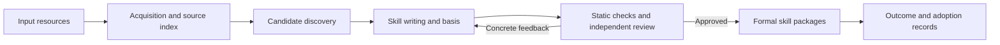

# Workflow examples

Each curated example shows how research resources become usable skill packages. Selected stage
records make the decisions and handoffs inspectable; portable configurations let readers try the
current pipeline. Formal packages live in [the skill library](../skills/README.md).

| Example | Resources and delivered capabilities |
| --- | --- |
| [EDBO reaction optimization](edbo-reaction-optimization/README.md) | Paper and pinned EDBO code; reaction-space encoding and initial experiment design |

## Follow the workflow



| Stage | Files to read | What they explain |
| --- | --- | --- |
| Recorded configuration | `recorded-input.json` | Supplied resources, guidance and effective limits for the illustrated run |
| Resource preparation | `sources.json` | Source identities, pinned versions and public file locators |
| Discovery | `discovery.json` | Proposed capabilities, software entrypoints, evidence and gaps |
| Writing | `records/<skill>/basis.json` and the linked `SKILL.md` | How inspected source passages support the delivered instructions |
| Checking and review | `records/<skill>/review.json` | Static checks, independent review, material feedback and its resolution |
| Delivery | `skills.json` | Accepted package locations, scope and file identities at publication |
| Batch result | `summary.json` | Accepted/deferred candidates, recorded model usage and acceptance limits |
| Current rerun | `input.json` | A reusable configuration for the current pipeline |

Read the example README first, then follow these stages. For a concrete instruction, start in the
linked skill, find its block in `basis.json`, and use the source ID in `sources.json` to inspect
the upstream file. Compare the review's concerns and resolutions with the final instructions.
`summary.json` explains how candidate selection relates to the delivered packages.

Recorded files describe the illustrated run. They are not a live export of current schemas,
defaults or package contents. Package fingerprints identify the recorded output; a later maintained
package may differ. A fresh build can make different decisions even from the same sources.

## Run the current pipeline

Prepare the prerequisites in the [project README](../README.md), then run from the repository root:

```text
python -m creation_pipeline build examples/edbo-reaction-optimization/input.json --preflight
python -m creation_pipeline build examples/edbo-reaction-optimization/input.json --no-adopt --state-dir ../chemical_skill/pipeline-state
```

Preflight validates configuration without fetching resources or calling a model. A real build
checks the model connection, fetches resources and can incur model usage. `--no-adopt` retains
approved packages in the state archive; omit it to publish non-conflicting packages. Use the same
state directory for later resume or retention commands. The current example configuration uses
production defaults with no candidate or model-call quota. `recorded-input.json` preserves the
illustrated run's settings for reference, rather than prescribing those limits for a new build.

## Example boundaries

Examples are selected and published manually. Completing a build does not trigger a new example
or refresh an existing example's recorded files. After reviewing run results, maintainers choose
suitable cases and assemble the selected records and walkthrough. Current rerun instructions
are maintained as the pipeline changes; recorded-run evidence remains tied to its illustrated run.

Keep the stage records needed to explain a complete workflow, useful review feedback and final
package links. State material interventions outside the automated stages and any limitations so a development demonstration
is not mistaken for a fully autonomous result. Keep credentials, raw conversations, caches,
large upstream trees, temporary troubleshooting and routine trial histories outside the repository.
Do not duplicate formal packages inside examples.

Source/content approval does not establish successful target-tool execution, scientific validation
or measured benefit to an agent. See [configuration](../docs/pipeline/configuration.md),
[acceptance](../docs/pipeline/acceptance.md) and [outputs](../docs/pipeline/outputs.md).
